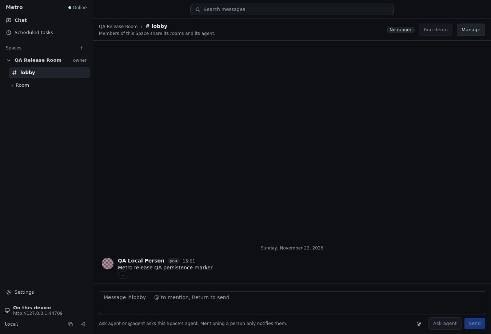
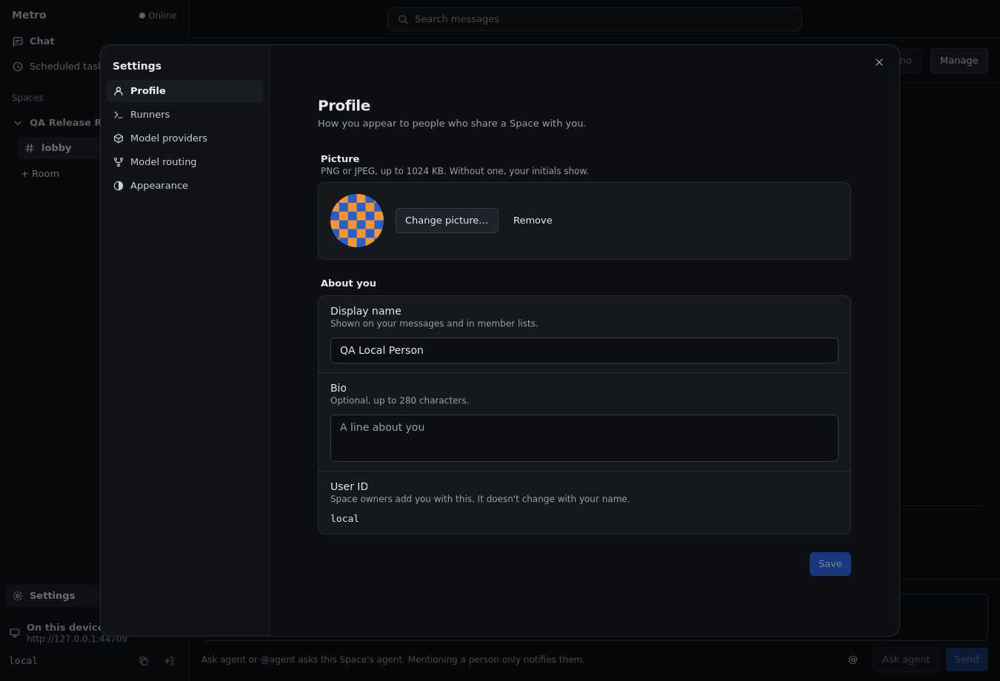
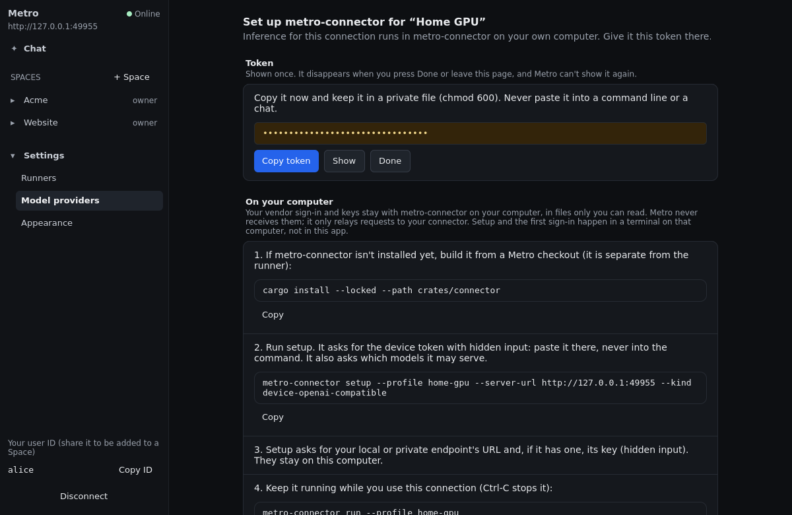
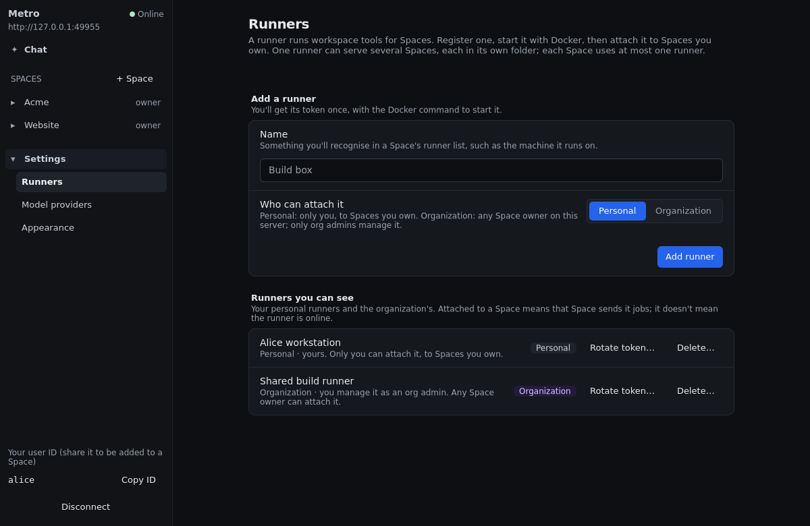
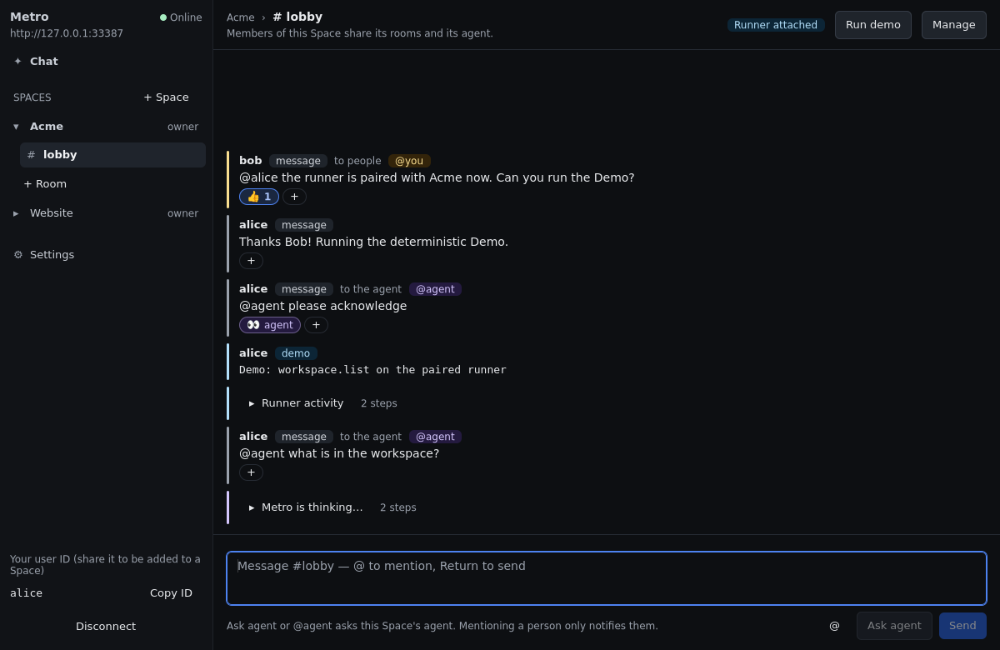
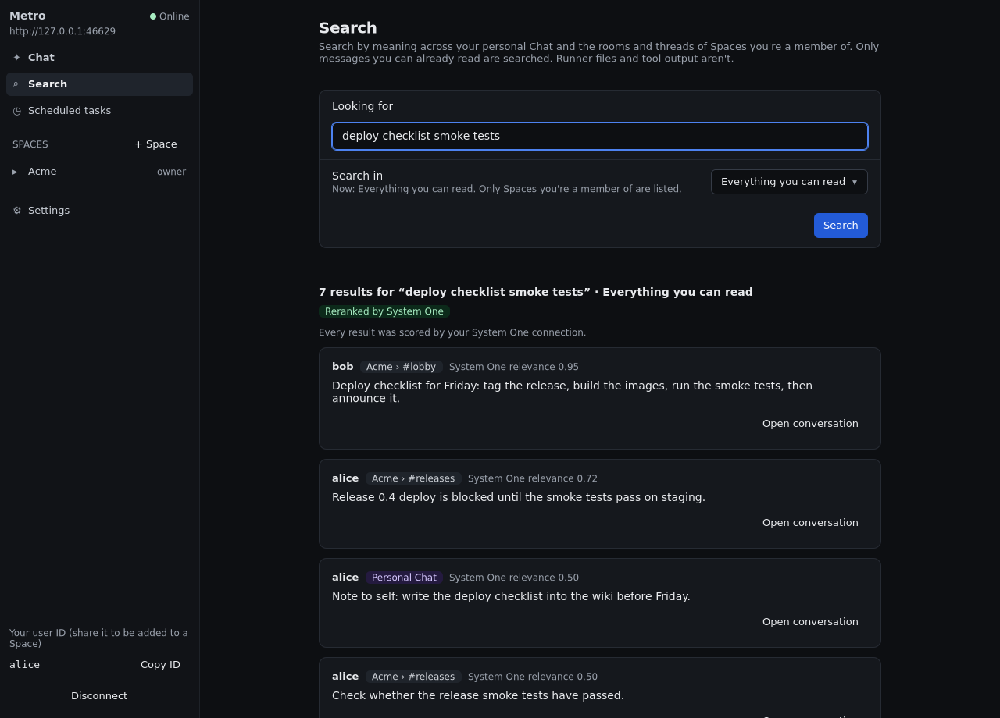
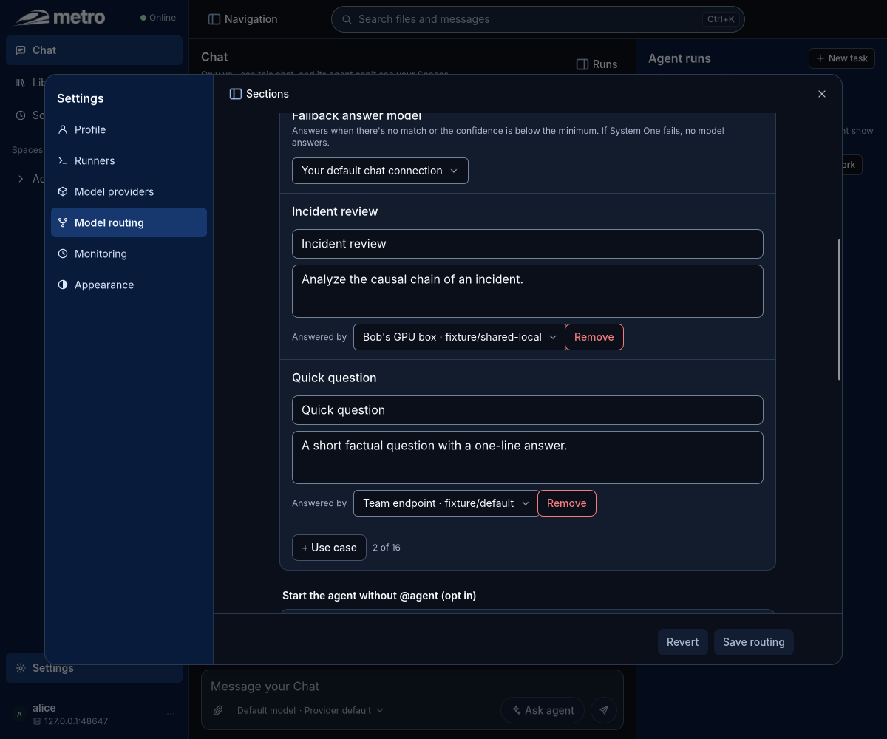
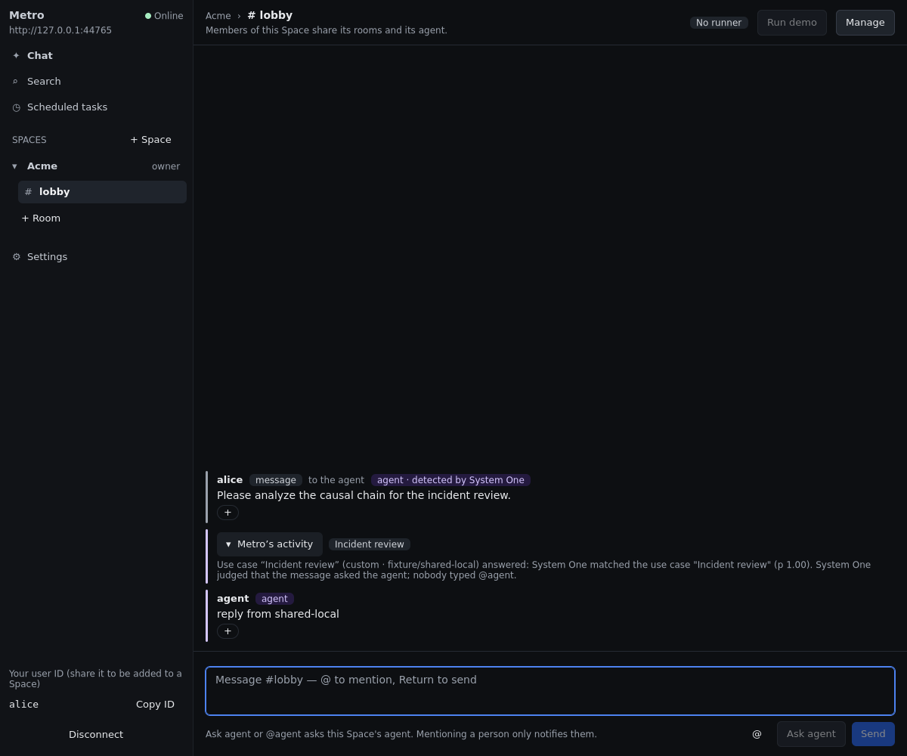
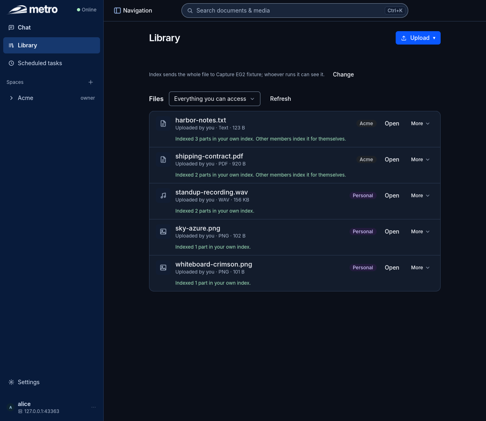

# Metro

Metro is a self-hosted place where people and an agent work together.

- **Personal Chat:** every user has a private Chat with the agent. It works
  even when they belong to no Spaces, and it shows their agent runs across
  Spaces.
- **Spaces:** private groups of rooms. Anyone can create one, and its owner
  decides who else joins. A Space's agent can hand work to **child threads**.
- **Runners:** a Space can use one optional runner, a process on someone's
  machine that gives the agent tools over that Space's directory. It's either
  dedicated to the Space, or a registered personal or organization runner
  that can serve several Spaces, each in its own directory.
- **Your own model:** each person picks their own model connection. It's
  either a connector on their own computer that keeps their vendor
  credentials there, or an API key the server stores encrypted.

| Part | Path | Stack |
| --- | --- | --- |
| Server | `crates/server` | Rust, [Axum](https://docs.rs/axum/latest/axum/), [SQLite](https://www.sqlite.org/docs.html), [Rig](https://rig.rs/) provider adapters, including custom OpenAI-compatible endpoints |
| Auth | `crates/auth` | Dev users or OIDC JWT access tokens ([details](crates/auth/README.md)) |
| Device connector | `crates/connector` | Outbound-only code that serves a person's own model connection from their computer ([details](docs/settings.md#device-connections)) |
| Runner | `crates/runner` | Rust, Linux ≥ 5.6. Tools: `workspace.list`, `workspace.read`, `workspace.check`, and optional [MCP](https://modelcontextprotocol.io/specification/latest) over stdio. Docker sandbox is opt-in. |
| Desktop | `apps/desktop` | TSX on [Native Shell](https://nsh.dev), with a replaceable design layer ([details](apps/desktop/README.md)) |
| Deploy | `compose.yaml`, `Dockerfile`, `.github/workflows/ci.yml` | Docker Compose; CI is set up to publish images to GHCR on `v*` tags, and nothing has been published yet |

What has been verified, and how to repeat it:
[docs/acceptance.md](docs/acceptance.md).

## Screenshots

The first two are from QA of the **0.2.0 Linux candidate** (built locally,
not published): the packaged app with its bundled local server, in Debian
13 under Xvfb, after quitting and reopening. The avatar is a synthetic test
image.

| | |
| --- | --- |
|  |  |
| Local workspace, reopened (0.2.0 Linux candidate) | Settings → Profile, reopened (0.2.0 Linux candidate) |

The rest are earlier native Linux (GTK) captures of the
[desktop app](apps/desktop/README.md) from development builds, running
against the real server and runner, so some screens look different in the
candidate. Agent replies and model lists come from a labelled, local
scripted model, not a real vendor, and the device connector is shown
offline.

| | |
| --- | --- |
|  |  |
| Room with collapsed tool activity | Settings: model providers |
|  |  |
| Device connection setup (token masked) | Settings: runners |
|  |  |
| A live agent turn, one collapsed group | The finished turn, opened |
|  |  |
| Semantic search (fixture models) | Scheduled tasks |
|  |  |
| Model routing | Route attribution on a real turn (fixture models) |
|  |  |
| Documents & media (scripted media endpoint) | File search by content (scripted vectors) |

More: [where your text goes](docs/screenshots/model-routing-dataflow.png) ·
[sharing a model](docs/screenshots/model-sharing.png) ·
[Space runner](docs/screenshots/settings-space-runner.png) ·
[appearance](docs/screenshots/settings-appearance.png) ·
[Chat and runs](docs/screenshots/chat-runs.png) ·
[child thread](docs/screenshots/thread.png) ·
[members](docs/screenshots/space-members.png) ·
[connect](docs/screenshots/connection.png) ·
[connect error](docs/screenshots/connection-error.png)

The native Linux app needs glibc ≥ 2.39, GTK ≥ 4.14, WebKitGTK 6.0 and the
GStreamer base plugins. Its native GUI checks ran in Debian 13 under Xvfb
with scripted local model endpoints. The Windows x64 candidate and later
Windows test archives have only been started under Wine on Linux: a window
opened and the bundled server answered health checks, but the window
rendered blank. Nobody has checked that it draws or takes input, or run it
on native Windows. macOS hasn't been tried.

## How it works

- **Who you are.** Your identity provider decides: a dev username, or the
  `sub` claim of an OIDC token. `GET /v1/me` returns your stable `id` (used for
  membership) and your display name, `actor`.
- **Profiles and times.** Each person has a display name, bio and avatar
  that only they and their current Space co-members can read. Every message
  carries the server's UTC `created_at`, and the agent sees those times on
  people's messages.
  Both are verified at the API, and editing your profile was verified in
  the 0.2.0 Linux candidate ([details](docs/spaces.md#profiles)).
- **Spaces are private.** Only members see a Space, its rooms and its threads.
  Only the owner adds or removes members, or chooses the Space's runner.
  Nobody can add themselves.
- **Addressing.** `@bob` speaks to Bob and never wakes the agent. `@agent`, or
  the **Ask agent** button, starts an agent reply. You can tag both in one
  message. Text with no tag is ordinary room conversation, and in your
  personal Chat it's a note to yourself. In the current source after 0.2.0
  (not released), personal Chat makes **Ask agent** the default for typed
  text when a chat model is ready and System One isn't set up, with **Save
  note** beside it ([details](apps/desktop/README.md#what-it-does)).
- **Reactions.** 👍 👀 ✅ 🙏 ❤️ 🎉 on human and agent messages, in Chat, rooms
  and threads. Click to toggle. A reaction never starts agent work. When the
  agent is addressed, it may answer with a single reaction instead of a
  redundant reply, but a reaction never means the work is done.
- **Threads.** A room's agent can create child threads, send them follow-ups,
  check their status and stop them. A thread inherits its Space's members and
  runner, keeps its own transcript, and posts its results back to the parent
  room.
- **Runs.** Chat lists the agent runs in your Spaces. You can open one, follow
  up, or stop it. You can stop your own runs, and an owner can stop any run in
  their Space.
- **Whose model.** Every agent run, child threads included, uses the default
  model connection of the person who started it. People without one fall
  back to the server's `METRO_MODEL`. A connection that can't be used fails
  the run with a clear error and never falls back silently
  ([details](docs/settings.md)). In the current source after 0.2.0 (not
  released), the composer's **Model** button can choose a model, and where
  supported a thinking level, for agent turns in your Chat or in a Space,
  from the connections you may use there. The server checks the choice
  again when the run starts, and a choice that's no longer allowed fails
  that turn ([details](docs/settings.md#which-model-a-run-uses)).
- **Demo vs Ask agent.** **Demo** runs a fixed `workspace.list` on the Space's
  runner and never calls a model. **Ask agent** uses the model chosen as
  above.
- **Appearance.** Dark by default, with Light and System in **Settings →
  Appearance**. Each agent turn shows as one collapsed group: *Metro is
  thinking…* while it runs, then *Metro’s activity*. Demo shows as *Runner
  activity*. Groups are built only from the events' public activity
  metadata. Metro shows no chain of thought of its own.

The full behaviour and the API are in [docs/spaces.md](docs/spaces.md).

**New in this build.** These are all opt-in:

- [Scheduled prompts](docs/schedules.md).
- [Separate chat, System One and embeddings connections](docs/settings.md#capabilities).
- [Sharing a connection](docs/settings.md#sharing-a-connection) with Spaces
  or the organization.
- [Opt-in classification and use-case routing](docs/system-one.md#how-a-message-reaches-the-agent).
- [Semantic search](docs/system-one.md#semantic-search).
- [Documents & media](docs/library.md): a library of files you upload
  yourself, with search by content.

They passed the
[Documents & media local gate](docs/acceptance.md#demonstrated-final-local-gate-with-documents--media-2026-11-22-primary-workspace-local):
497 Rust tests, all seven e2e scripts, the 83 hardened media-service tests,
and desktop `nsh test` 106/106. The current final result is the
[Metro 0.2.0 local release](docs/acceptance.md#final-metro-020-local-release-prepublication-2026-11-23-project-manager-local). That gate used local fixtures, scripted
models and a test-only encoder only. **No commercial vendor has been
validated, and nothing has been released.** See
[docs/system-one.md](docs/system-one.md).

**About Documents & media.** It holds only files you upload yourself, to
your personal library or to a Space you're a member of. You index them on
request through a media-capable connection built around
[`google/embeddinggemma-2`](https://huggingface.co/google/embeddinggemma-2).
It's separate from message search, which doesn't change. It's verified
locally with real PDF and DOCX bytes, scripted media vectors, and a 3 MiB
and an 8 MiB payload through the device relay
([details](docs/acceptance.md#demonstrated-documents--media-with-synthetic-fixtures-2026-11-22-qa-local)).
**No pretrained weights were downloaded, so ranking quality hasn't been
tested.** Native audio and video playback, seeking, and the native file
picker for library uploads weren't verified.

## Install and use (prebuilt only)

Nothing here builds Metro from source. Building from a checkout is for
contributors and lives in [docs/development.md](docs/development.md).

> **Release status.** The public repository is
> <https://github.com/wnzn/metro>. **No release has been published yet.**
> Version 0.2.0 is planned to put `Metro-0.2.0-windows-x64.zip`,
> `Metro-0.2.0-linux-x64.tar.gz` and `Metro-runner-0.2.0-linux-x64.tar.gz`
> (each with a `.sha256`) on the
> [Releases page](https://github.com/wnzn/metro/releases), and the images
> `ghcr.io/wnzn/metro-server` and `ghcr.io/wnzn/metro-runner` on GitHub
> Container Registry. These names are verified targets. The 0.2.0
> files have been built and verified locally
> ([evidence](docs/acceptance.md#final-metro-020-local-release-prepublication-2026-11-23-project-manager-local)), but nothing is public until the release is
> published
> ([docs/deploy.md](docs/deploy.md#release-files-and-images)).

There are two ways to use Metro:

- **On your own (solo).** Install the desktop app and choose **Use
  locally**. The app starts its bundled Metro server on this computer,
  just for you, and keeps your data between launches. There's no server
  URL, environment file or token to set up, and the data is separate from
  any server you connect to. Verified with the 0.2.0 Linux candidate,
  where the button was still labelled *Open local workspace*
  ([acceptance](docs/acceptance.md)). On Windows it has only been started
  under Wine.
- **With other people (shared server).** One operator runs the Metro server
  for the team (steps 1–2 below). Everyone else installs only the desktop
  app and connects to it (step 3).

| Who | Installs | From |
| --- | --- | --- |
| Everyone | **Metro desktop**: `Metro-<version>-windows-x64.zip` (portable) or `Metro-<version>-linux-x64.tar.gz` | the Releases page |
| The operator of a shared server | **Metro server**: `ghcr.io/wnzn/metro-server` | GHCR |
| Optional, whoever holds a Space's files | **Metro runner**: `ghcr.io/wnzn/metro-runner` or `Metro-runner-<version>-linux-x64.tar.gz` | GHCR or the Releases page |

**Model access.** Server-stored API profiles need no extra install: the
server calls the provider. **Device connections** run on your own computer,
inside the desktop app, so you don't install or start a separate terminal
program. In a packaged Linux build, QA paired an endpoint on this computer
through **Settings → Connect this device**, with no token or terminal, and
the agent answered through it. That was against a local test endpoint, not
a real vendor ([status](docs/settings.md#device-connections)). Vendor software that you
choose to use with Metro, such as the Claude Code CLI, is always separate.
Install and update it yourself, from its vendor.

### 1. Shared server: start it and bootstrap the workspace admin

On the server host (Docker, Linux):

1. Pick the first admin's username, for example `admin`, and generate their
   token into a private file. Put it in the server's environment file,
   together with `METRO_ORG_ADMINS`. Nothing is printed.
2. Start the published server image. It listens on `127.0.0.1:8787` only.
3. Open the admin panel **from the server itself**, or through an SSH port
   forward or trusted HTTPS (below), and sign in with that token.

The full commands are in
[docs/deploy.md](docs/deploy.md#install-the-server). The admin panel is at
`/admin` on the same origin as the API, and `/` redirects there. From
there the admin creates one **local account** per person, rotates or revokes
their tokens, and hands each token over privately. It's shown once.

- **No one is added to any Space automatically.** Local accounts, admins
  included, start with no Spaces. People create their own Spaces, and a Space
  owner adds members by their stable id.
- **Local accounts and OIDC are separate modes.** A server either uses
  local accounts (the bootstrap admin from `METRO_DEV_USERS` plus the ones
  the admin creates) or an OIDC identity provider, never both. With OIDC,
  your provider issues and revokes sign-ins, and the admin panel has no
  accounts to manage ([docs/auth.md](docs/auth.md)).

### 2. Shared server: reach it safely

A bearer token must never cross a network in clear text.

- **On the server itself:** `http://127.0.0.1:8787` works.
- **From your own computer, no HTTPS yet:** forward a local port over SSH,
  then use `http://127.0.0.1:8080` in the desktop app and in your browser:

  ```sh
  ssh -N -L 8080:127.0.0.1:8787 you@your-metro-host
  ```

- **For a team:** put a TLS-terminating reverse proxy in front of
  `127.0.0.1:8787` and use its `https://` URL.

If you open the server over plain `http://` on a LAN address, the admin page
loads only as a landing page: it refuses to take a token and shows the SSH
forward to use instead. The desktop app refuses plain `http://` to any
non-loopback host for the same reason. Your server's address is specific to
your deployment. Metro has no built-in default other than loopback.

### 3. Everyone: install the desktop app and connect

Download the desktop build for your system from the Releases page.
Per-user installers for the desktop and the runner, including the Linux
library check (`--install-deps` is opt-in), are described in
[docs/install.md](docs/install.md). The Linux ones passed in a local test
cut on Debian 13 and CachyOS; none is released or signed, and the Windows,
macOS and container ones haven't been run in a recorded test.

- **Linux:** extract `Metro-<version>-linux-x64.tar.gz` and start its
  launcher. Needs glibc ≥ 2.39, GTK ≥ 4.14, WebKitGTK 6.0 and the GStreamer
  base plugins; the package names for Debian, Ubuntu, Arch and CachyOS are
  in the [desktop README](apps/desktop/README.md#runtime-requirements). The
  app can run from a read-only install location.
- **Windows:** extract the whole portable ZIP and run `Metro\Metro.exe`
  (Windows 10 1809+ or 11, x64). It hasn't been tested on native Windows
  ([status](apps/desktop/README.md#windows-portable-package)).

- **Solo:** choose **Use locally** under *On this computer*.
- **Shared server:** enter the server URL from step 2 and paste the token
  your admin gave you. There's no built-in login yet. Close token files
  before you screen-share.
- In the current source after 0.2.0 (not released), Metro opens **On this
  computer** at launch. Use **Add a server…** in the account menu for a
  shared server, and **Startup server…** to choose what opens at launch
  ([details](apps/desktop/README.md#install-users)).
- If something doesn't work, see
  [troubleshooting](apps/desktop/README.md#troubleshooting). Never send
  anyone your tokens, keys, sign-in files or raw logs.

### 4. Try it

- **New Space**, then **Manage → Add member** with a colleague's stable id.
  Everyone finds their own under **Settings → Profile → User ID**, and with
  local accounts the admin panel lists each account's id.
- Set your display name and picture in **Settings → Profile**.
- In the Space's **lobby**, write `@bob hello`. Bob sees it, and the agent
  stays quiet.
- React to a message with 👍, then click it again to remove it.
- For the agent, pick a model in **Settings → Model providers**, then write
  `@agent ...` in the lobby or talk to it privately in **Chat**. The operator
  can also set a fallback model (`METRO_MODEL`, see
  [docs/settings.md](docs/settings.md#operator-settings)) for people who
  haven't chosen one.

### 5. Optional: tools over a Space's files

**In your local workspace: local tools.** In a Space you own in your own
local workspace, **Manage → Local tools on this computer → Turn on local
tools** lets that Space's agent list and read files (`workspace.list`,
`workspace.read`) in one private folder on this computer, per Space, while
Metro is open. The agent can't change files, run commands or see anything
else on your disk. There's nothing extra to install, and it's only offered
when the Space has no other runner. QA turned it on for two Spaces in a
packaged Linux build: each Space's listing showed only its own folder, and
turning one off left the other on.

**On a shared server, or for checks and commands: a runner.** An operator
installs it separately. A runner gives a Space's agent list and read tools over a directory on the
machine that runs it. It's published as a container image and as a Linux
binary, and needs **Linux ≥ 5.6** because it confines file access with
`openat2`. The image runs as UID/GID 1000, so the directory you mount must
be readable (and, for a registered runner, writable) by that user.

- **Dedicated runner:** serves exactly one Space. Its owner issues the token
  under **Manage → Runner**.
- **Registered runner:** personal or organization-wide, attached by Space
  owners to their own Spaces, each in its own `spaces/<sid>/` directory.

Step-by-step: [docs/runners.md](docs/runners.md) and
[docs/runner.md](docs/runner.md).

## More docs

- [docs/spaces.md](docs/spaces.md): Spaces, members, mentions, reactions,
  threads, Chat, runs, runner pairing, the API, and upgrading
- [docs/auth.md](docs/auth.md): local accounts and OIDC providers
- [docs/settings.md](docs/settings.md): the Settings sections, personal model
  connections, device connections, provider keys, org admins, and appearance
- [docs/runners.md](docs/runners.md): dedicated and registered runners, who
  manages them, per-Space directories, and Docker setup
- [docs/runner.md](docs/runner.md): runner settings, remote runners, the
  Docker sandbox, time limits, and crash cleanup
- [docs/deploy.md](docs/deploy.md): installing the server, the admin panel
  and local accounts, safe access, release files, CI/CD, and trust boundaries
- [docs/schedules.md](docs/schedules.md): scheduled prompts, demonstrated
  end to end with scripted models
- [docs/system-one.md](docs/system-one.md): the System One milestone, with
  each part's status and evidence
- [docs/acceptance.md](docs/acceptance.md): evidence, and how to reproduce it
- [apps/desktop/README.md](apps/desktop/README.md): the desktop app and its
  design layer
- [docs/development.md](docs/development.md): building from source, for
  contributors only
- [AGENTS.md](AGENTS.md): how the project is built
