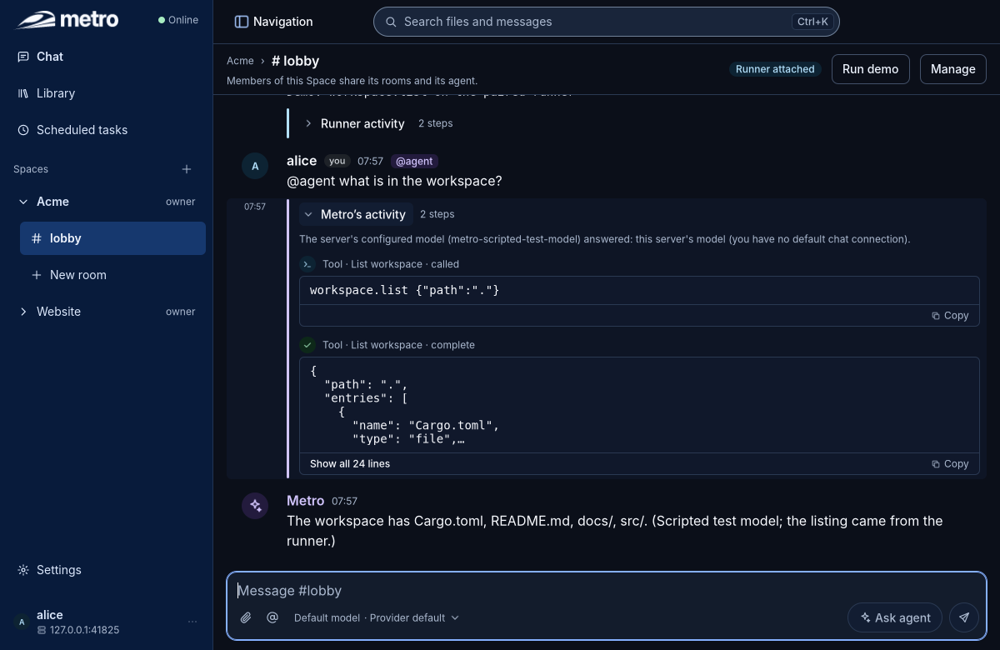
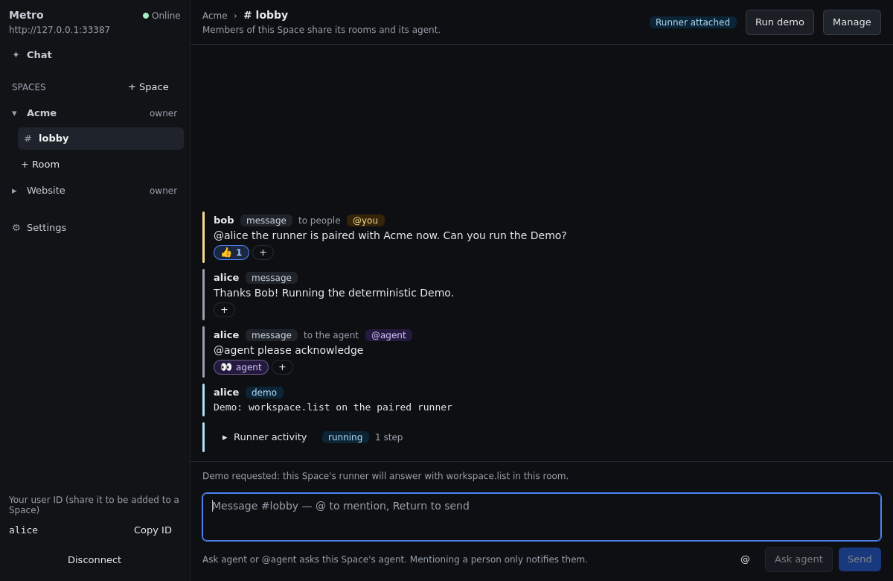
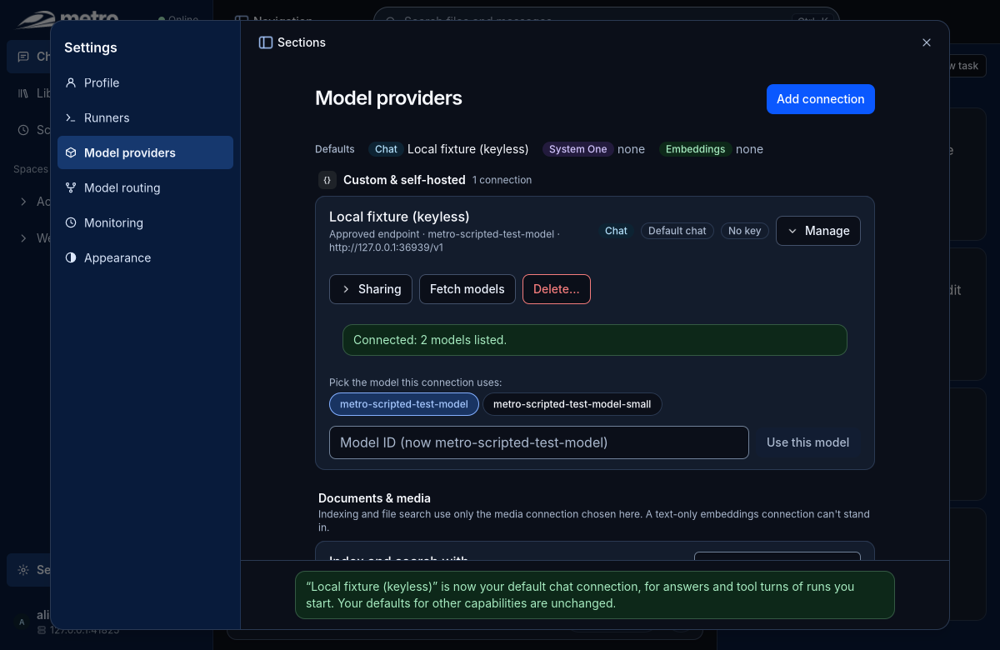
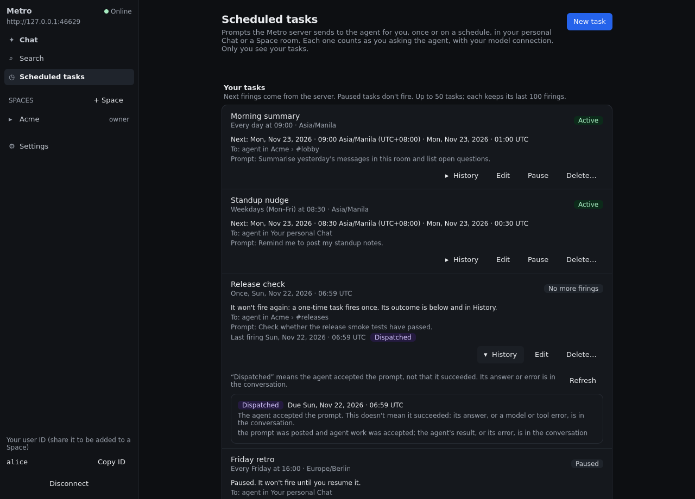

  <picture>
    <source media="(prefers-color-scheme: dark)" srcset="apps/desktop/assets/brand/metro-dark.svg">
    
  </picture>

  A self-hosted place where people and an agent work together.

  <a href="#get-started">Install</a> ·
  <a href="#documentation">Docs</a> ·
  <a href="https://github.com/wnzn/metro/releases">Releases</a>

  

Metro is a chat app for you or your team, with an agent built in. You run the
server yourself, or let the desktop app run one just for you. Each person
brings their own model, and each Space can give the agent tools over its
own files.

## Features

- **Personal Chat:** a private conversation with the agent, plus your agent runs across Spaces.
- **Spaces:** private groups of rooms. Only members see them, and only the owner adds people.
- **Child threads:** a room's agent can hand work to bounded threads that report back.
- **Clear addressing:** `@bob` only notifies Bob. `@agent` or **Ask agent** starts the agent.
- **Your own model:** a device connection keeps your vendor sign-in or key on your computer; a server-stored API profile keeps an encrypted key on the server.
- **Runners (optional):** give one Space's agent tools over that Space's own directory.
- **Native desktop app** with reactions, profiles, and dark and light themes.

Opt-in extras:

- **Scheduled prompts:** the agent gets your prompt once or on a recurrence, in Chat or a room.
- **Classification and use-case routing:** System One decides whether an unaddressed message is for the agent, and which of your models answers.
- **Semantic search:** embeddings over what you can already read, reranked by System One.
- **Documents & media:** files you upload yourself, indexed on request and searchable by content.

## Screenshots

| | |
| --- | --- |
|  |  |
| People and the agent in a room | Personal Chat and agent runs |
|  |  |
| Model providers | Scheduled prompts |
|  |  |
| Semantic search | Documents & media search |

Agent replies and model lists in these screenshots come from a local
scripted model; System One and embeddings use local fixtures.

## Get started

**Solo.** Install the desktop app and choose **Use locally**. It starts a
bundled Metro server on your computer, just for you, with no URL or token
to set up. Details: [docs/install.md](docs/install.md).

**Team.** An operator runs the `ghcr.io/wnzn/metro-server` image, with
local accounts or OIDC sign-in. Everyone else installs the desktop app and
connects with the server's URL and their own token. Details:
[docs/deploy.md](docs/deploy.md).

Send tokens only over loopback, an SSH port forward or HTTPS. The desktop
app refuses plain `http://` to any other host.

> **No release is published yet.** The verified target names are
> `Metro-<version>-windows-x64.zip`, `Metro-<version>-linux-x64.tar.gz` and
> `Metro-runner-<version>-linux-x64.tar.gz` (each with a `.sha256`), and
> the images `ghcr.io/wnzn/metro-server` and `ghcr.io/wnzn/metro-runner`.
> There's no macOS build for now, and Windows hasn't been tested natively.
> Windows release files will ship **unsigned** (no Authenticode signature)
> until a code-signing certificate is set up, so expect SmartScreen
> warnings and check them against the Sigstore-signed `SHA256SUMS`
> ([docs/install.md](docs/install.md#desktop-on-windows)).
> What's verified so far: [docs/acceptance.md](docs/acceptance.md).

## Repository layout

| Path | What it is |
| --- | --- |
| [`crates/server`](crates/server) | Server: Rust, Axum, SQLite, Rig model adapters |
| [`crates/auth`](crates/auth) | Local accounts and OIDC sign-in |
| [`crates/connector`](crates/connector) | Device connections, served from a person's own computer |
| [`crates/runner`](crates/runner) | Runner: per-Space tools, optional Docker sandbox |
| [`crates/desktop`](crates/desktop) | Desktop launcher and bundled local server |
| [`crates/model-protocol`](crates/model-protocol) | Model wire types and System One client |
| [`crates/tui`](crates/tui) | `metro-tui`, a terminal client |
| [`apps/desktop`](apps/desktop) | Desktop app in TSX on [Native Shell](https://nsh.dev) |
| [`services/`](services) | Reference media embedding service |
| [`packaging/`](packaging) | Release archives, images and installers |
| [`tests/e2e/`](tests/e2e) | End-to-end tests against the real binaries |
| [`docs/`](docs) | User and operator docs |

## Documentation

| Doc | About |
| --- | --- |
| [Install](docs/install.md) | Desktop and runner installers |
| [Deploy](docs/deploy.md) | Running a server for a team |
| [Spaces](docs/spaces.md) | Spaces, Chat, addressing, the API |
| [Auth](docs/auth.md) | Local accounts and OIDC |
| [Settings](docs/settings.md) | Model connections, sharing, appearance |
| [Runners](docs/runners.md) | Dedicated and registered runners |
| [Runner](docs/runner.md) | Runner settings and the Docker sandbox |
| [Schedules](docs/schedules.md) | Scheduled prompts |
| [System One](docs/system-one.md) | Classification, routing, semantic search |
| [Library](docs/library.md) | Documents & media |
| [Terminal](docs/terminal.md) | The `metro-tui` client |
| [Desktop app](apps/desktop/README.md) | The app, requirements, troubleshooting |
| [Acceptance](docs/acceptance.md) | What's verified, and how to repeat it |
| [Development](docs/development.md) | Building from source |
| [AGENTS.md](AGENTS.md) | Project rules for contributors |

## Contributing

Building from source, running the tests and taking screenshots are covered
in [docs/development.md](docs/development.md). Read
[AGENTS.md](AGENTS.md) before you change behaviour or docs.
