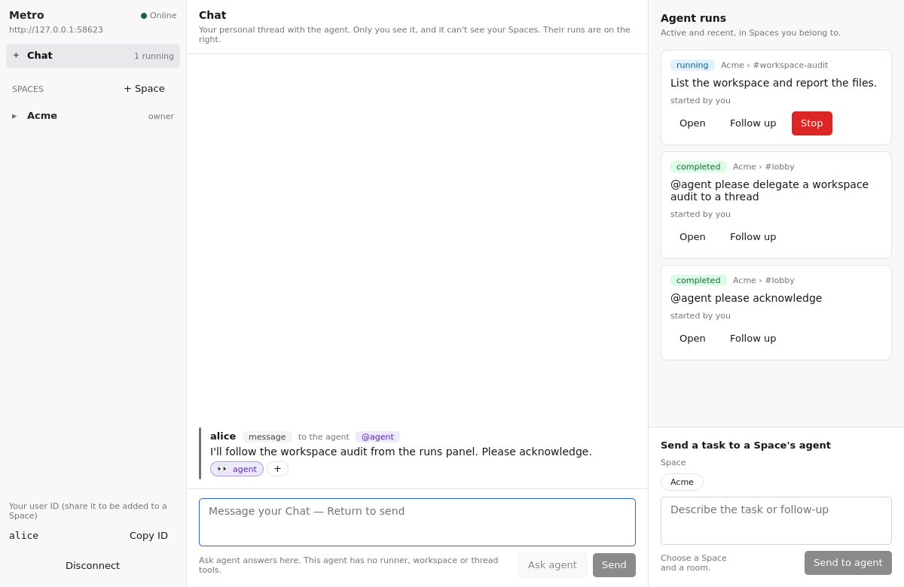
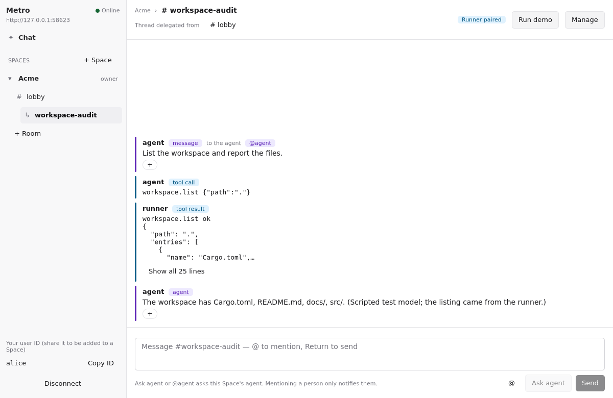
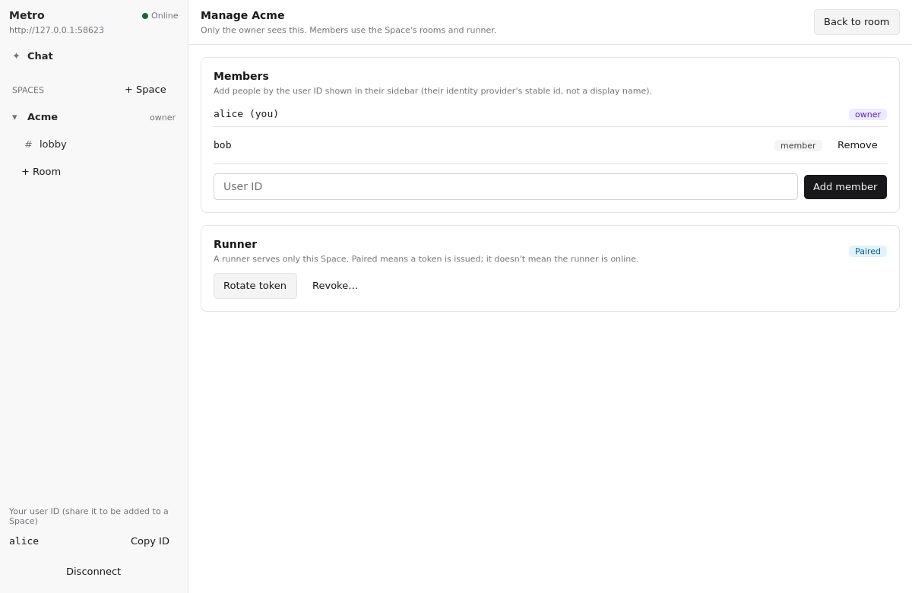
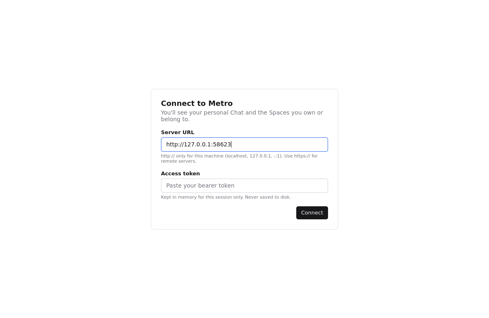
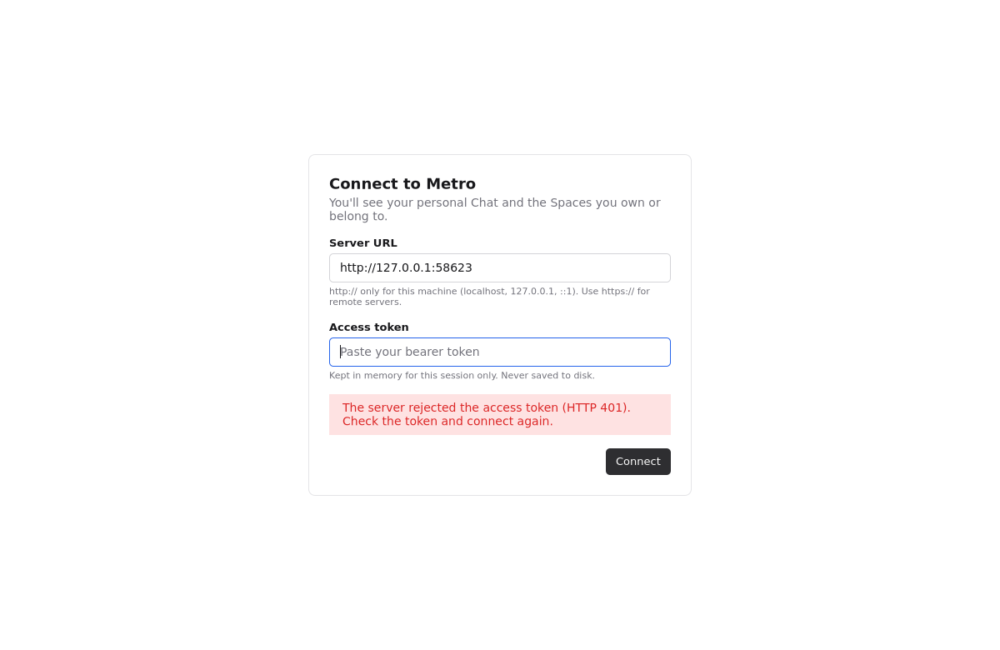

# Metro

Metro is a self-hosted place where people and an agent work together.

- **Personal Chat:** every user has a private Chat with the agent. It works
  even when they belong to no Spaces, and it shows their agent runs across
  Spaces.
- **Spaces:** private groups of rooms. Anyone can create one, and its owner
  decides who else joins. A Space's agent can hand work to **child threads**.
- **Runners:** a Space can pair with an optional runner, a process on someone's
  machine that gives the agent tools over one workspace directory.

| Part | Path | Stack |
| --- | --- | --- |
| Server | `crates/server` | Rust, [Axum](https://docs.rs/axum/latest/axum/), [SQLite](https://www.sqlite.org/docs.html), [Rig](https://rig.rs/) over any OpenAI-compatible Chat Completions endpoint |
| Auth | `crates/auth` | Dev users or OIDC JWT access tokens ([details](crates/auth/README.md)) |
| Runner | `crates/runner` | Rust, Linux ≥ 5.6. Tools: `workspace.list`, `workspace.read`, `workspace.check`, and optional [MCP](https://modelcontextprotocol.io/specification/latest) over stdio. Docker sandbox is opt-in. |
| Desktop | `apps/desktop` | TSX on [Native Shell](https://nsh.dev), with a replaceable design layer ([details](apps/desktop/README.md)) |
| Deploy | `compose.yaml`, `Dockerfile`, `.github/workflows/ci.yml` | Docker Compose; CI publishes images to GHCR on `v*` tags |

What has been verified, and how to repeat it:
[docs/acceptance.md](docs/acceptance.md).

## Screenshots

These are native Linux (GTK) captures of the [desktop app](apps/desktop/README.md),
running against the real server and runner. The agent's replies come from a
labelled scripted stand-in model, not a real one.

| | |
| --- | --- |
|  |  |
| Room with a paired runner | Personal Chat and agent runs |
|  |  |
| Child thread | Members and runner (owner) |
|  |  |
| Connect | Connect error |

The native Linux app needs glibc ≥ 2.39, GTK ≥ 4.14 and WebKitGTK 6.0. macOS
and Windows haven't been tried.

## How it works

- **Who you are.** Your identity provider decides: a dev username, or the
  `sub` claim of an OIDC token. `GET /v1/me` returns your stable `id` (used for
  membership) and your display name, `actor`.
- **Spaces are private.** Only members see a Space, its rooms and its threads.
  Only the owner adds or removes members, or manages the runner token. Nobody
  can add themselves.
- **Addressing.** `@bob` speaks to Bob and never wakes the agent. `@agent`, or
  the **Ask agent** button, starts an agent reply. You can tag both in one
  message. Text with no tag is ordinary room conversation.
- **Reactions.** 👍 👀 ✅ 🙏 ❤️ 🎉 on human and agent messages, in Chat, rooms
  and threads. Click to toggle. A reaction never starts agent work. When the
  agent is addressed, it may answer with a single reaction instead of a
  redundant reply, but a reaction never means the work is done.
- **Threads.** A room's agent can create child threads, send them follow-ups,
  check their status and stop them. A thread inherits its Space's members and
  runner, keeps its own transcript, and posts its results back to the parent
  room.
- **Runs.** Chat lists the agent runs in your Spaces. You can open one, follow
  up, or stop it. You can stop your own runs, and an owner can stop any run in
  their Space.
- **Demo vs Ask agent.** **Demo** runs a fixed `workspace.list` on the Space's
  runner and never calls a model. **Ask agent** uses the configured model.

The full behaviour and the API are in [docs/spaces.md](docs/spaces.md).

## Quickstart: two people, one Space, optional runner

You need Docker with Compose v2, `openssl` and `python3`, on Linux ≥ 5.6 (or
Docker Desktop).

### 1. Dev users, with tokens kept off screen

Each token is written to a mode-600 file outside the repo. Nothing is printed,
and existing token files and an existing `.env` are never overwritten.

```sh
D="${XDG_CONFIG_HOME:-$HOME/.config}/metro-dev"
mkdir -p "$D" && chmod 700 "$D"
( umask 077
  for u in alice bob; do [ -e "$D/$u.token" ] || openssl rand -hex 32 > "$D/$u.token"; done
  if [ -e .env ]; then
    echo ".env already exists; check that METRO_DEV_USERS matches $D" >&2
  else
    printf "METRO_DEV_USERS='{\"alice\":\"%s\",\"bob\":\"%s\"}'\n" \
      "$(cat "$D/alice.token")" "$(cat "$D/bob.token")" > .env
  fi )
```

`.env` is git-ignored. Use dev users only on your own machine; for anything
shared, see [docs/auth.md](docs/auth.md).

### 2. Start the server

```sh
docker compose up --build -d
curl -fsS http://127.0.0.1:8787/healthz
```

This starts only the server, on `127.0.0.1:8787`. The runner is in a separate
Compose profile, so it starts only when you ask for it.

### 3. Alice creates a Space and adds Bob

In the desktop app (step 5), use **New Space**, then **Manage → Add member**.
Or do the same from a shell:

```sh
BASE=http://127.0.0.1:8787
ALICE_TOKEN="$(cat "$D/alice.token")"; BOB_TOKEN="$(cat "$D/bob.token")"
api() { tok="$1" method="$2" path="$3" body="${4:-}"
  curl -fsS -X "$method" -H "Authorization: Bearer $tok" \
    ${body:+-H 'Content-Type: application/json' -d "$body"} "$BASE$path"; }
json() { python3 -I -c 'import json,sys; print(json.load(sys.stdin)[sys.argv[1]])' "$1"; }

SPACE="$(api "$ALICE_TOKEN" POST /v1/spaces '{"name":"Alice and Bob"}' | json id)"
BOB_ID="$(api "$BOB_TOKEN" GET /v1/me | json id)"
api "$ALICE_TOKEN" POST "/v1/spaces/$SPACE/members" "{\"user_id\":\"$BOB_ID\"}"
```

Always add people by the `id` they get from `/v1/me` (or from **Copy ID** in
the desktop app). With dev users it's the username. With OIDC it's an opaque
`sub`.

### 4. Optional: pair a runner

Alice issues the Space's runner token straight into a private file, then
starts the bundled runner with it:

```sh
TOKEN_FILE="$D/$SPACE.runner-token"
[ -e "$TOKEN_FILE" ] && echo "$TOKEN_FILE exists; issuing again would rotate the token" >&2 \
  || ( umask 077; api "$ALICE_TOKEN" POST "/v1/spaces/$SPACE/runner-token" '{}' | json token > "$TOKEN_FILE" )
METRO_RUNNER_TOKEN="$(cat "$TOKEN_FILE")" docker compose --profile runner up --build -d runner
```

The runner serves `examples/workspace` to every room and thread in this
Space. It runs with `METRO_SANDBOX=none`, and has no check unless you add
`METRO_CHECK_ARGV='["./check.sh"]'` to `.env`. Whenever Compose recreates the
container, pass the token again the same way. In the desktop app, an owner can
also issue the token under **Manage → Runner**. It's shown once.

### 5. Open the desktop app as Alice and as Bob

Install [Native Shell](https://nsh.dev) 0.6.x (see
[apps/desktop/README.md](apps/desktop/README.md#requirements)). Then, from the
repo root on Linux, start one window per person:

```sh
nsh run apps/desktop --target linux
```

Enter `http://127.0.0.1:8787` and paste that person's token from its file.
There's no built-in login yet. Close the token files before you screen-share.

### 6. Try it

- In the Space's **lobby**, write `@bob hello`. Bob sees it, and the agent
  stays quiet.
- React to a message with 👍, then click it again to remove it.
- With a runner paired, click **Run demo**. The workspace listing appears, and
  no model is involved.
- For the agent, add a model to `.env`, then run `docker compose up -d server`:

  ```sh
  METRO_MODEL=your-model-id
  METRO_MODEL_BASE_URL=https://api.openai.com/v1
  METRO_MODEL_API_KEY=replace-with-your-key
  ```

  Write `@agent ...` in the lobby, or talk to it privately in **Chat**. Any
  OpenAI-compatible endpoint works, including a local one.

To stop, run `docker compose --profile runner down`. Add `-v` only if you also
want to delete the database.

## More docs

- [docs/spaces.md](docs/spaces.md): Spaces, members, mentions, reactions,
  threads, Chat, runs, runner pairing, the API, and upgrading
- [docs/auth.md](docs/auth.md): dev users and OIDC providers
- [docs/runner.md](docs/runner.md): runner settings, remote runners, the
  Docker sandbox, time limits, and crash cleanup
- [docs/deploy.md](docs/deploy.md): self-hosting, CI/CD, and trust boundaries
- [docs/acceptance.md](docs/acceptance.md): evidence, and how to reproduce it
- [apps/desktop/README.md](apps/desktop/README.md): the desktop app and its
  design layer
- [AGENTS.md](AGENTS.md): how the project is built
