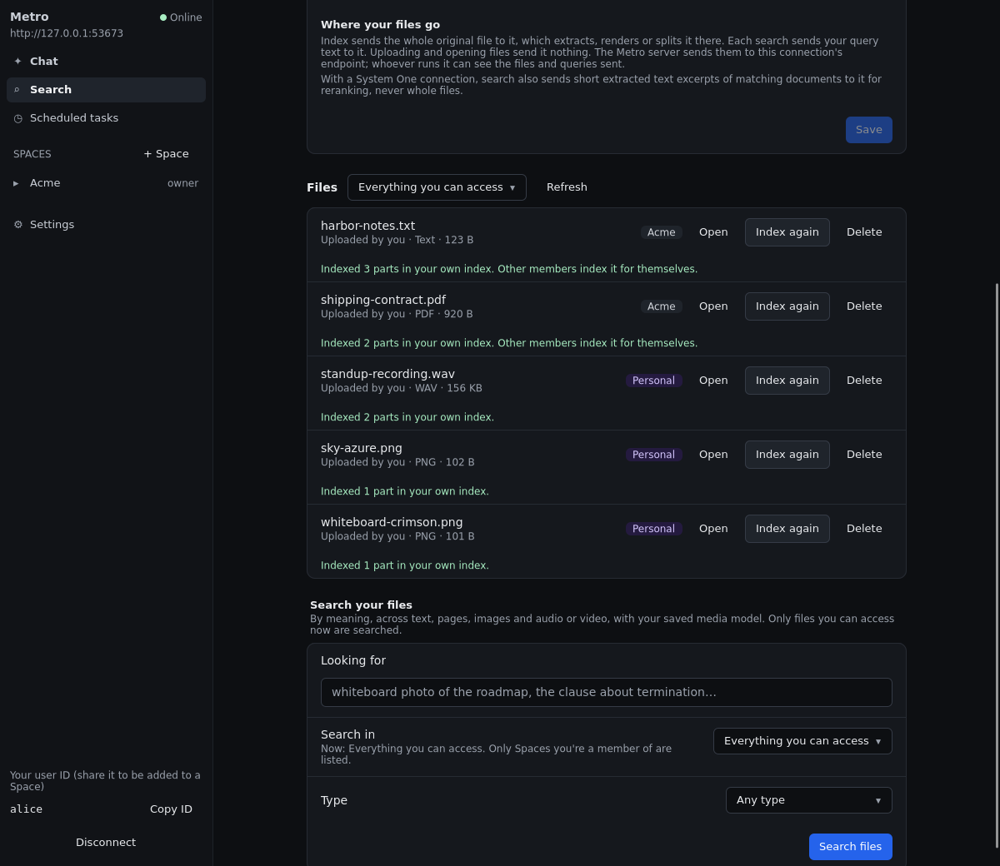
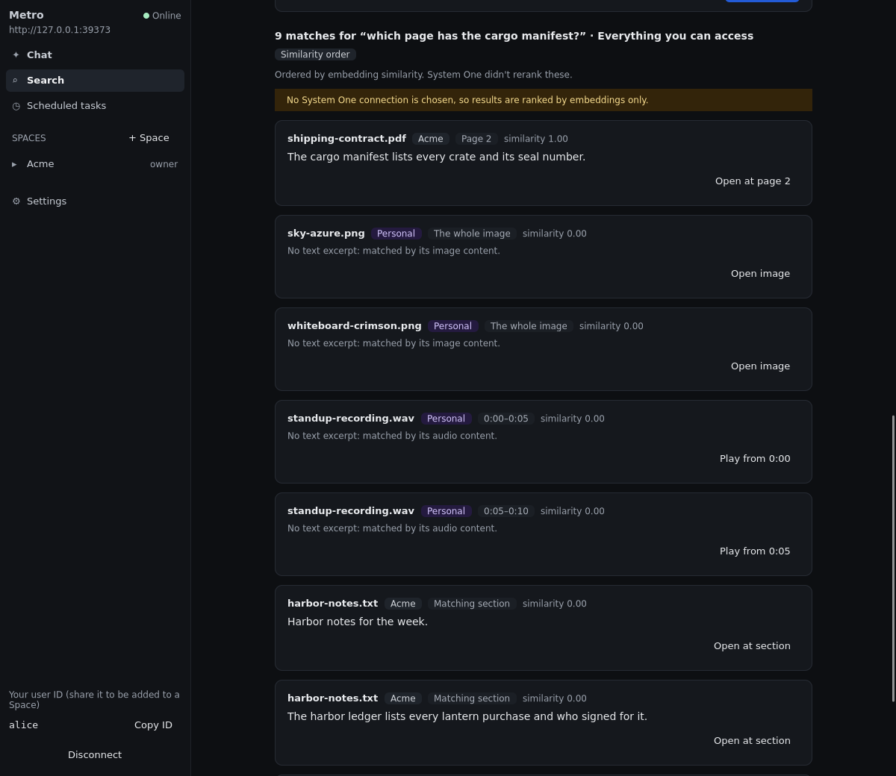
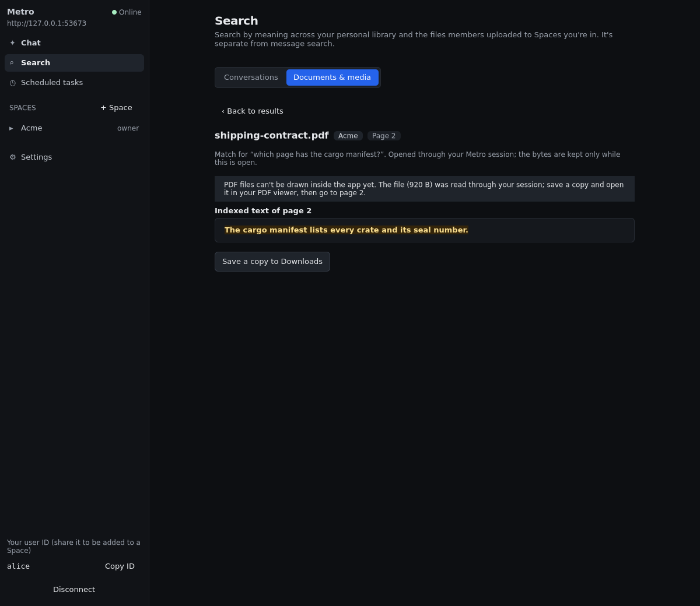
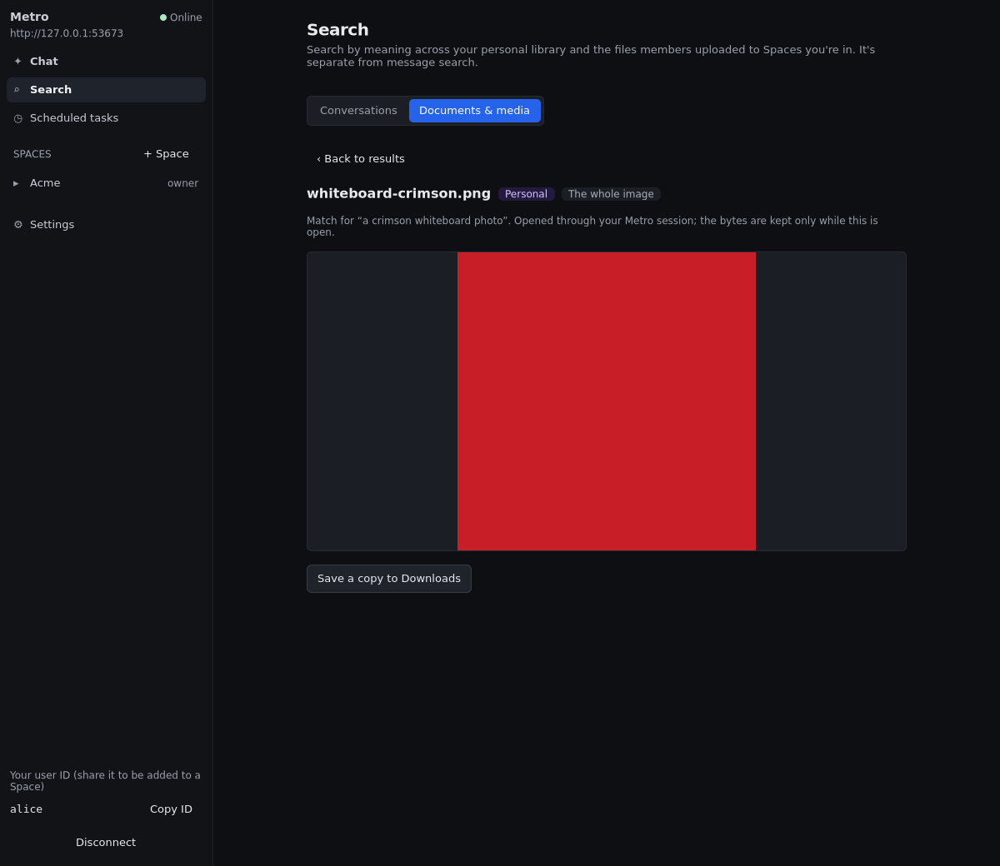
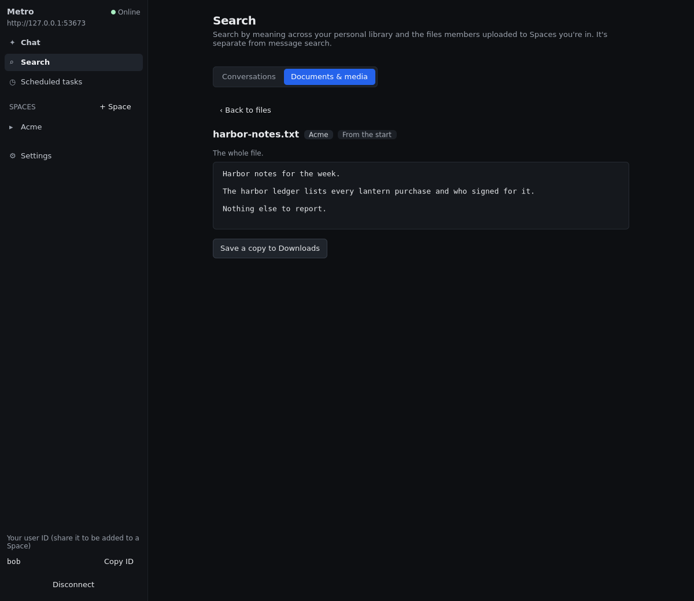
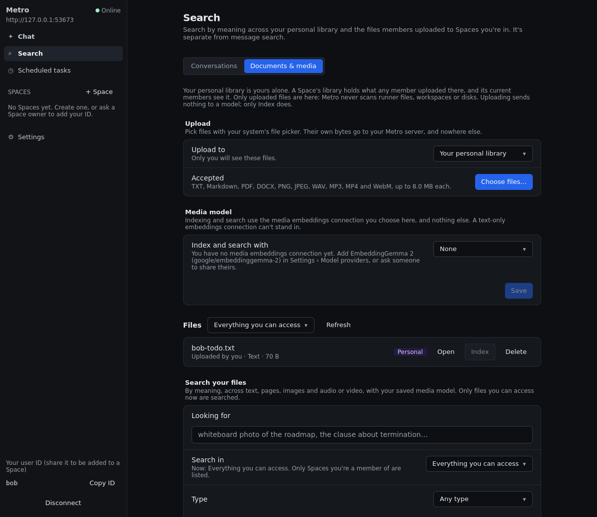

# Documents & media

> **Status: verified locally with fixtures. Not released.** It's part of the
> [final local gate](acceptance.md#demonstrated-final-local-gate-with-documents--media-2026-11-22-primary-workspace-local):
> 497 Rust tests, all seven e2e scripts (`library.py` ran twice), the 83
> hardened media-service tests, and desktop `nsh test` 106/106. **No
> pretrained weights were downloaded, so no ranking quality has been
> tested.**
>
> - **Upload, file access, indexing and search** are in
>   `crates/server/src/library.rs`, `library/`, `library_search.rs` and
>   `library_search/`. QA ran `tests/e2e/library.py` against the real
>   `metro-server` and `metro-connector`, with a **scripted** media vendor
>   that extracts text and returns vectors deterministically. A real PDF and
>   a real DOCX, and payloads of 3 MiB and exactly 8 MiB sent unchanged through
>   the device relay, passed with
>   access checks enforced
>   ([acceptance.md](acceptance.md#demonstrated-documents--media-with-synthetic-fixtures-2026-11-22-qa-local)).
> - **The reference service** (`services/embeddinggemma2/`,
>   `compose.media.yaml`), after its hardening, passed 83 weight-free tests
>   in three places: on the host, in the Docker test build, and in the test
>   image run with the runtime's restrictions. Its hardened, non-root
>   runtime image started and passed its own sandbox self-test. Metro's
>   upload, index and search path was also run through the service's real
>   HTTP app, on synthetic TXT and PNG, with a test-only encoder
>   (`tests/e2e/library_reference.py`).
>
>   How the decoder is isolated, and what that was checked against, is in
>   [Decoder isolation](#decoder-isolation).
> - **Not shown:**
>   - any ranking by the real pretrained `google/embeddinggemma-2`, because
>     no weights have been downloaded,
>   - native audio or video playback or seeking, or the native file picker
>     (portal), and
>   - any public release.
> - **Desktop:** `nsh check` is clean, and `nsh test .` passed 106/106 twice.
>   Six native Linux screenshots were taken against the real server, with a
>   scripted media endpoint. See [In the desktop app](#in-the-desktop-app).
>
>   See [Not yet recorded](#not-yet-recorded).

The **Documents & media** library is a second, separate search corpus. It
holds only files that someone **explicitly uploads**:

- to their **personal library**, which only the uploader can see, or
- to a **Space** they're a member of, which only that Space's current
  members can see.

It doesn't replace or change the existing [message
search](system-one.md#semantic-search). That search keeps working exactly as
before, over your personal Chat and the rooms and threads of your Spaces,
with your own `embeddings` connection and the optional System One rerank.

## What is never in the library

- **Runner files and workspaces.** Metro never scans a runner's `spaces/<sid>/`
  root, a repository, or any folder on anyone's machine to fill the library.
  A file is in the library only because a person uploaded it.
- **Chat attachments that nobody uploaded.** Nothing is pulled in from
  messages, tool output or activity.
- **Other people's personal files.** There's no admin or operator bypass.
  Org admins can't see members' personal libraries.

## Who can see what

Every operation checks access **at the moment of the request**, against the
library's own records and current Space membership. That covers list, read
metadata, preview, download, search, index, and every model call made while
indexing.

| Asset | Who can upload and read it | Who can delete it |
| --- | --- | --- |
| Personal | The uploader only | The uploader |
| In a Space | Any current member of that Space | The uploader while they're still a member, or the Space owner |

A Space member who is neither of those gets `403` on delete. An uploader
who has been removed from the Space gets `404`, like any outsider. Org admins
get no extra rights over personal libraries or Spaces they're not in.

- A Space asset belongs to the Space. If you leave a Space, or the owner
  removes you, its assets stay for the remaining members. You lose access
  immediately, because the next list, search, preview, download or index
  request runs the check again. Search results are filtered again just
  before they're returned, so a result can't leak through a search that
  started before you were removed.
- An asset you can't see is answered with `404`, the same as one that
  doesn't exist, following the [Space rules](spaces.md).
- When an asset is deleted, its index entries are deleted with it.
- Content from one Space goes only to model calls made for that Space. It
  never goes into a call made for another Space or for your personal
  library. The same rule applies to [message
  search](system-one.md#semantic-search).

## Accepted files

Each upload is checked three ways: its declared MIME type, its filename
extension, and the signature in its first bytes. All three must name the
same format, or the upload is refused. Names are reduced to a plain basename
of at most 255 bytes. Empty files are refused.

| Kind | Extension | Stored MIME type |
| --- | --- | --- |
| Text | `.txt` | `text/plain` (must be UTF-8 without NUL bytes) |
| Markdown | `.md`, `.markdown` | `text/markdown` (same check; `text/x-markdown` is also accepted on upload) |
| PDF | `.pdf` | `application/pdf` |
| Word | `.docx` | `application/vnd.openxmlformats-officedocument.wordprocessingml.document` |
| Image | `.png`, `.jpg`, `.jpeg` | `image/png`, `image/jpeg` |
| Audio | `.wav`, `.mp3` | `audio/wav` (also `audio/x-wav`, `audio/wave`, `audio/vnd.wave` on upload), `audio/mpeg` (also `audio/mp3`) |
| Video | `.mp4`, `.webm` | `video/mp4`, `video/webm` |

`application/octet-stream` is refused. A `charset` parameter is allowed only
on text types, and only as UTF-8.

The validator interprets nothing beyond the signature, the UTF-8 check, and,
for DOCX, a bounded read of the ZIP directory: it reads file names only and
decompresses nothing. Scripts, macros, links and URLs inside a file are
never followed or run. This is `crates/server/src/library/validate.rs`.

## Upload and file API

All routes need a signed-in person. Space membership is checked before the
upload body is read, and again when the row is written.

| Request | Result |
| --- | --- |
| `GET /v1/library/assets?scope=personal\|space\|all[&space_id=][&limit=1..200][&cursor=]` | `{"assets": [Asset], "next_cursor": string\|null, "max_file_bytes"}`, newest first. `scope` defaults to `all`, `limit` to 50. |
| `POST /v1/library/assets?scope=personal\|space[&space_id=]&name=<url-encoded basename>` | The raw file is the body, and `Content-Type` is the file's MIME type. Returns `201` with the `Asset`. |
| `GET /v1/library/assets/{id}` | The `Asset` |
| `GET` or `HEAD /v1/library/assets/{id}/content` | The bytes. A single `Range` gives `206`, or `416` with `Content-Range: bytes */N`. A multi-range request gets the whole file with `200`. |
| `DELETE /v1/library/assets/{id}` | `204`. The blob and its index rows go with it. |

An `Asset` is `{"id", "name", "mime_type", "kind", "size_bytes", "space_id"
(null for personal), "uploader_id", "sha256", "created_at" (Unix ms)}`.

The content route always downloads, and never renders inline. It sends
`Content-Disposition: attachment` with an encoded filename,
`X-Content-Type-Options: nosniff`, `Cache-Control: no-store`,
`Content-Security-Policy: default-src 'none'; sandbox`,
`Cross-Origin-Resource-Policy: same-origin` and `Referrer-Policy:
no-referrer`.

| Status | When |
| --- | --- |
| `400` | A bad name, a bad scope and `space_id` combination, or an unknown query key |
| `403` | Delete by a member who is neither the uploader nor the Space owner |
| `404` | An asset you can't see, or a Space you're not a member of |
| `413` | The file is over the size limit, or a quota is full |
| `415` | An unsupported type, or a MIME type, extension and signature that don't agree |
| `408` | The upload was too slow: over the total time limit, or idle longer than the idle limit |
| `416` | An unsatisfiable `Range` |
| `429` | You already have your maximum number of uploads in progress |
| `503` | Every server upload slot stayed busy for 10 seconds. Try again. |

Example, after the [contributor quickstart](development.md#two-people-one-space-from-a-shell).
It reuses `$D` (the directory holding the mode-600 token files) and `$SPACE`:

```sh
curl -fsS -X POST \
  -H "Authorization: Bearer $(cat "$D/alice.token")" \
  -H 'Content-Type: application/pdf' \
  --data-binary @q3-review.pdf \
  "http://127.0.0.1:8787/v1/library/assets?scope=space&space_id=$SPACE&name=q3-review.pdf"

# Bob, a member, lists the Space's files; an outsider would get 404
curl -fsS -H "Authorization: Bearer $(cat "$D/bob.token")" \
  "http://127.0.0.1:8787/v1/library/assets?scope=space&space_id=$SPACE"
```

These commands follow the routes in the code. They haven't been run as
written here.

## Limits and operator settings

| Setting | Default | Allowed |
| --- | --- | --- |
| `METRO_LIBRARY_MAX_FILE_BYTES` | 8 MiB (8388608) | 1 to 8 MiB |
| `METRO_LIBRARY_USER_QUOTA_BYTES` | 256 MiB | the file limit to 64 GiB. It counts everything a person uploaded, personal and Space. |
| `METRO_LIBRARY_SPACE_QUOTA_BYTES` | 1 GiB | the file limit to 64 GiB |
| `METRO_LIBRARY_MAX_FILES_PER_USER` | 2000 | 1 to 1,000,000 |
| `METRO_LIBRARY_MAX_CONCURRENT_UPLOADS` | 4 | 1 to 64. These slots bound the memory used by buffered uploads, server-wide. |
| `METRO_LIBRARY_MAX_UPLOADS_PER_USER` | 2 | 1 to the concurrent-upload limit. A person over it gets `429`, so one person can't take every slot. |
| `METRO_LIBRARY_UPLOAD_TIMEOUT_SECS` | 120 | 1 to 600. The total time allowed for one upload body. |
| `METRO_LIBRARY_UPLOAD_IDLE_TIMEOUT_SECS` | 20 | 1 to the upload timeout. The longest gap allowed with no bytes arriving. |

A value out of range, or one that isn't a whole number, stops the server
from starting. It isn't clamped silently. A list page holds at most 200
assets.

**With Compose:** `compose.yaml` passes all eight `METRO_LIBRARY_*`
variables to the server from `.env`, `--env-file` or the shell. If one is
unset or blank, the server uses its default.

## The model: EmbeddingGemma 2

Media search is designed around Google DeepMind's open
[`google/embeddinggemma-2`](https://huggingface.co/google/embeddinggemma-2)
(note the hyphen, Apache-2.0). It isn't the first-generation
[EmbeddingGemma](https://huggingface.co/google/embeddinggemma-300m), which
is text only. It also isn't the hosted [Gemini Embedding
2](https://ai.google.dev/gemini-api/docs/embeddings), which is a different
model with a different vector space. Its vectors can't be mixed with this
model's.

What the [model
card](https://huggingface.co/google/embeddinggemma-2/blob/f9972ac22e696a105c482202646979e33e4b5a1e/README.md)
and the [pinned processor
config](https://huggingface.co/google/embeddinggemma-2/blob/f9972ac22e696a105c482202646979e33e4b5a1e/processor_config.json)
say, at the revision the reference service pins
(`f9972ac22e696a105c482202646979e33e4b5a1e`):

- **One shared space.** Text (including code), images, video and audio are
  mapped into a single 768-dimensional space. So a text query like *"whiteboard
  photo of the Q3 roadmap"* can be compared directly with an image's
  vector. The model has 740M parameters: a 270M text model, a 170M vision
  encoder and a 300M audio encoder.
- **Dimensions.** The native output is 768. Matryoshka truncation to 512,
  256 or 128 is supported, and vectors must be L2-normalized again after
  truncation. A query and the documents it's scored against must use the
  same dimension. Metro's default is **768**.
- **Text prompts.** Text inputs take a task prefix. For retrieval, queries
  use `prompt_name="SearchQuery"` (`task: search result | query: …`) and
  documents use `prompt_name="Document"` (`title: none | text: …`). A
  document with a real title is written as `title: {title} | text: {content}`.
  Images, audio and video take **no** prefix.
- **Context.** All modalities share one 8,192-token window. By default an
  image costs 280 tokens. Video is sampled at 1 frame per second, at 140
  tokens per frame, and the pinned processor keeps at most 32 frames,
  sampled uniformly when there are more. Audio must be **mono at 16 kHz**.
  It costs 40 ms per token, and the pinned processor uses 280 tokens per
  segment, about 11.2 s. The card's *about 327 seconds* is what fits in the
  whole context budget. It doesn't promise that one long clip becomes one
  vector.
- **Precision.** Run it in `bfloat16` or `float32`. The card warns that
  `float16` gives NaN or silently degraded vectors.
- **No native PDF or DOCX input.** The model takes text, pixels and
  waveforms. A PDF has to be preprocessed first: its text is extracted for
  text search, and its pages are rendered to images for visual search. A
  DOCX contributes extracted text only. A filename, caption or base64 string
  passed as text isn't a media embedding and is never presented as one.
- **Limitations from the card.** Quality varies by language and domain.
  Leaving out the text prefix lowers quality. 128 dimensions noticeably
  degrades multimodal quality. The model has no safety tuning. It's an
  embedding model, so how results are filtered is up to the application.
  Metro filters them with the access checks above.

### How the reference service prepares each file

When you index a file, Metro's server sends the whole original, unchanged,
to your media connection. That includes PDF and DOCX. The [reference
service](#optional-stack-composemediayaml) then turns it into segments.
The model itself never gets a raw PDF or DOCX. These limits come from
`services/embeddinggemma2/metro_eg2/limits.py`:

| File | What becomes a segment | Excerpt |
| --- | --- | --- |
| TXT, Markdown | UTF-8 text in chunks of up to 1,200 characters, cut at a paragraph, line or space | Real extracted text |
| DOCX | Body paragraph text from `word/document.xml` only. Headers, relationships, external templates, embedded objects and fields aren't read. The XML is parsed with `defusedxml`, so no DTDs or entities. | Real extracted text |
| PDF, page with text | That page's extracted text, in chunks. The locator is the 1-based page. | Real extracted text |
| PDF, page with little or no text (fewer than 32 non-space characters, such as a scan) | The page is rendered without forms or annotations, and embedded as an **image**. No OCR is done. | None |
| PNG, JPEG | The decoded RGB pixels (first frame only), downscaled to at most 1,536 px on a side | None |
| WAV, MP3 | Mono 16 kHz audio, in 8-second windows. A trailing remainder under 0.5 s is dropped, and the file is reported partial. | None |
| MP4, WebM | Frames sampled at 1 per second and downscaled to at most 768 px, in 16-second windows of up to 16 frames. **The audio track isn't embedded.** The allowed codecs are H.264, HEVC, VP8, VP9, AV1 and MPEG-4. | None |

**Service limits** (`metro_eg2/limits.py`):

| Limit | Value |
| --- | --- |
| Decoded file / raw request body | 8 MiB / 12 MiB |
| Segments per file | 48. A longer file is indexed as `partial`. |
| Text before chunking (TXT, Markdown, DOCX) | 2,000,000 characters |
| DOCX | 2,000 ZIP entries. `document.xml` up to 16 MiB uncompressed, at a compression ratio of at most 200. |
| PDF | 48 pages examined. Pages up to 200 in (14,400 pt) a side. Rendered pages up to 1,536 px a side and 2.4 MP. |
| Images | Up to 8,192 px a side and 40 MP |
| Audio | Up to 8 channels and a 192 kHz source rate |
| Video | Up to 4,096 px a side and 4096×2304 pixels, and up to 54,000 decoded frames (after that the file is `partial`) |
| Decoder process | 3 GiB of address space, 90 s of CPU, 64 open files, a maximum file size of 0, and no core dumps |
| Query text | 8,000 characters (Metro itself sends at most 1,000) |
| Excerpt | 240 characters |

Every file is held in memory only. The service never opens a URL, stream,
path or external reference inside a file:

- MP4 data references are off.
- The PDF renderer runs without a form environment, so PDF JavaScript and
  XFA don't run, and embedded files aren't opened.
- The file name is checked to be a bare basename, and is then ignored.

#### Decoder isolation

The decoders are FFmpeg (through PyAV), pdfium, Pillow and numpy. They never
run in the service process. Each file gets a fresh worker process:

1. **A clean environment.** The worker gets an allowlisted environment
   only: no key-file path, no Hugging Face settings and no proxies. Only
   stdin and stdout are open, and it runs in its own session.
2. **Resource limits**, as in the table above.
3. **Non-dumpable and `no_new_privs`**, set while the worker is still
   single-threaded and before any decoder library is loaded.
4. **Landlock**, which needs ABI 3 or later. The worker may read only the
   Python runtime, the service package and the system libraries, and
   read and write only its own `0700` temp directory. With ABI 4 or later,
   TCP is denied. With ABI 6 or later, signals and abstract UNIX sockets
   outside the sandbox are denied too.
5. **A seccomp-BPF filter** on all threads. It denies:
   - sockets,
   - `ptrace` and `process_vm_*`,
   - exec, fork, and new processes (threads are allowed),
   - signals to other processes,
   - mount, namespace, keyring, bpf, perf, io_uring and module calls,
   - permission and ownership changes.

   The wrong architecture kills the worker.

**It fails closed.** If any restriction can't be applied, the service won't
start. A request that meets the same failure gets `503
sandbox_unavailable`, and the file isn't decoded. The worker's output is
treated as untrusted. It's length-prefixed JSON and raw arrays, never
pickle, and every type, shape, size, locator and string is validated before
it reaches the model. On a deadline or a client disconnect, the worker's
process group is killed and reaped.

**What it was checked on.**

- **The host:** Linux 6.12 with Landlock ABI 6 and the kernel's own
  security controls. No privileged container, capability or Docker socket
  was needed.
- **Docker 29.9.1**, with its default seccomp profile, `--read-only`,
  `--cap-drop ALL`, `no-new-privileges` and a non-root user.
- **A probe with harmless test files.** Run on the host, it confirmed that
  the worker was **denied**:
  - access to a sibling job's files,
  - `/proc/<parent>/environ`,
  - other files such as `/etc/hostname`,
  - loopback TCP and a UNIX socket,
  - signals, `ptrace` and `process_vm_readv` against the parent, and
  - fork and exec.

  It still had threads and its own temp directory.

**Requirements and limits.**

- It needs Linux 6.2 or later, with `landlock` in the active LSM list
  (`cat /sys/kernel/security/lsm`), on x86_64 or aarch64.
- The container runtime must allow the `landlock_*` and `seccomp` system
  calls. Podman, Kubernetes `RuntimeDefault` and gVisor haven't been
  verified, so run the service's test image on them first.
- macOS and Windows can't decode at all.
- The seccomp filter is a deny-list, so system calls added in future
  kernels are allowed unless they're listed.
- The worker runs as the same UID as the service. The separation comes from
  the kernel controls, not from a different user.
- The model process itself isn't sandboxed. It receives only validated
  arrays and text.

Nothing is invented. Images, scanned pages, audio and video have no text
excerpt. No model caption or transcript is shown as their content.

## Connections: why a separate media adapter

Your message-search `embeddings` connection speaks OpenAI's text wire, `POST
/v1/embeddings` with `input: string[]`
([reference](https://platform.openai.com/docs/api-reference/embeddings/create)).
That wire carries strings only, so it can't carry a file. Documents & media
uses its own adapter, `metro-media-embeddings`, with two connection types:

| Connection type (provider id) | Where it runs | Who sees what you index |
| --- | --- | --- |
| **EmbeddingGemma 2 on an approved endpoint** (`embeddinggemma-2`) | Called by the Metro **server**, at a base URL that must match `METRO_PROVIDER_ALLOWED_BASE_URLS` exactly. The API key is optional, write-only, and encrypted at rest. | Whoever runs that endpoint |
| **EmbeddingGemma 2 (on your device)** (`device-embeddinggemma-2`) | Your own `metro-connector`, which calls an endpoint reachable from your machine. The key stays on your device. | You, the device owner, including other people's files if you share the connection |

Both are marked `media_inputs: true` in `GET /v1/models/available`. Only
those can be chosen for Documents & media.

| Endpoint | Use it for Documents & media? |
| --- | --- |
| Metro's reference service, `POST /v1/media/embeddings` (Metro's own typed contract, not a Google or OpenAI standard) | **Yes.** It's what this adapter calls. |
| vLLM serving `google/embeddinggemma-2`. It uses `POST /v1/embeddings` with a vLLM-only `messages` extension for images ([vLLM docs](https://docs.vllm.ai/en/latest/models/pooling_models/embed/)). | **No.** It's a different request shape, and no matching adapter exists. |
| llama.cpp `llama-server`. It has its own embeddings routes. | **No.** Same reason. |
| OpenAI or any other text-only `/v1/embeddings` | **No.** A text-only connection is refused with `422`. Keep it for message search. |

The reference service also serves a text-only, OpenAI-shaped `POST
/v1/embeddings`, so it can serve message search as well. That doesn't
make other `/v1/embeddings` servers media-capable.

**Choosing your connection.** The choice is yours alone, and it's separate
from message search's `embedding_id`:

- `GET /v1/library/settings` returns `{"embedding_id", "suggested_id"?}`.
  A suggestion appears only when your message-search connection is itself
  media-capable. It's never saved for you.
- `PUT /v1/library/settings` takes `{"embedding_id": "pc_…" | null}`.
  - A text-only connection gives `422`.
  - A connection that's unknown, or that you can't use, gives `409`.
  - Choosing a **different** connection, or `null`, deletes your whole
    library index. Saving the same id again keeps it.
- Nothing falls back to another person's connection, to `METRO_MODEL` or to
  a text endpoint. Sharing follows the [existing rules](settings.md), and
  every use checks the grant again for the file's own Space.

### The media provider contract

Both connection types speak the same wire, `metro-media-embeddings`, which
is defined in `crates/model-protocol/src/media.rs`. It's Metro's own
contract. No standard embeddings API is assumed to accept media.

```text
POST {base_url}/media/embeddings        (base_url includes /v1; Bearer key if set)

{"model": "google/embeddinggemma-2", "query": "<text>"}
{"model": "google/embeddinggemma-2",
 "asset": {"name": "<basename>", "mime_type": "<type>", "data_base64": "<bytes>"}}

→ {"model"?, "data": [{"index", "embedding": [..], "locator", "modality"?, "excerpt"?}],
   "partial": bool, "notes"?: [..]}
```

- **A query** gets exactly one row, with the locator `{"kind": "query"}`.
- **An asset** gets 1 to 48 rows. Each row's locator is one of these:

  | Locator | Fields |
  | --- | --- |
  | `text` | `start`, `end`, both or neither |
  | `page` | `page` (1-based), with optional `start` and `end` |
  | `image` | none |
  | `time` | `start_ms`, `end_ms` |

- **`modality`** is `text`, `image`, `audio` or `video`, and it must fit the
  locator. For example, a scanned PDF page is a `page` locator with the
  modality `image`.
- **`notes`** are the service's remarks, such as that a video's audio track
  isn't embedded. Metro treats them as untrusted text: it sanitizes them,
  keeps at most 16 notes of 300 characters, and never follows them as
  instructions.
- **Rows that aren't text**, such as images, scanned pages and clips, carry
  no `excerpt`.
- **Assets travel as bytes only**, never as a URL or a file path, so the
  service never fetches anything. Names are bare basenames, and the type
  must be one of the library's ten.
- **Bounds:**
  - an asset of 8 MiB,
  - a request of 11 MiB,
  - a query of 32 KiB,
  - vectors of at most 4,096 dimensions (768 by default),
  - an excerpt of 2,048 bytes on the wire,
  - a response of 8 MiB from a server-side endpoint,
  - a 240 s time limit.
- **A response that doesn't fit** the contract is an error. Metro never
  guesses.
- **Prompts:** the service applies the query and document prompts itself.
  Metro sends the role only through the shape of the request.

## What leaves the server, and when

| Action | What is sent | To whom |
| --- | --- | --- |
| Upload, list, read metadata, download, delete | **Nothing**, to any model | No model. A download goes only to you, after the access check. |
| **Index** (you press it, for files you can read now) | The **whole original file** | Your chosen media connection, for that file's own destination (none for a personal file, its Space otherwise) |
| **Search** files you've already indexed | Your **query text** | Your chosen media connection, for each destination searched |
| Search, with a System One connection chosen | At most 10 **document text excerpts** (at most 1,000 characters each) and your query, one pair per call, each sent for its own source | Your System One connection |
| Search, with nothing indexed in scope | **Nothing**. No model is called. | No one |

- A search never sends a file. Image, audio and video bytes, rendered pages
  and unindexed originals don't leave just because a search ran.
- File names are never used for ranking.
- **Whoever runs an endpoint can see what's sent to it.** That includes the
  operator of a server-side endpoint, and the owner of a shared device or
  connection. They may also pay for the compute.
- **Anything already delivered can't be taken back.** Revoking a
  membership or a share, deleting a file, or changing your connection
  stops future sends. It doesn't recall bytes, excerpts or queries that an
  endpoint has already received.

## In the desktop app

Open **Search** and choose **Documents & media**. The screenshots below are
native Linux captures. They were taken against the real `metro-server`
binary, with a **scripted** media endpoint, so the scores show only that
the wiring works and say nothing about ranking quality. The files in them
were uploaded through the real authorized HTTP upload. The native file
picker was tested headless only. A native (portal) picker hasn't been
verified.

| | |
| --- | --- |
|  |  |
| Files, media model and the notice about where files go | Results: similarity order, no System One chosen |
|  |  |
| A PDF match: the indexed text of page 2 | An image match, shown in the app |
|  |  |
| Bob viewing an Acme file… | …after the owner removes him: personal files only |

**What the screen does:**

- **Upload** to your personal library or to a Space you're in. The screen
  lists the accepted types and the size limit, and says that uploading
  sends nothing to a model.
- **Media model** offers only media-capable connections. A text-only
  embeddings connection can't be picked. Under it, **Where your files go**
  says what pressing **Index** and running a search send, and to whom.
- **Files** lists what you can access now, each with a **Personal** or Space
  badge, **Open**, **Index** or **Index again**, and **Delete**. Each status
  line says your index is your own, and that other members index a Space
  file for themselves.
- **Search** results show the file, its badge, the locator (*Page 2*, *The
  whole image*, *0:05–0:10*, *Matching section*) and a labelled score. Media
  results say *No text excerpt: matched by its image content* (or audio
  content) instead of showing invented text. The ranking badge and the
  notice say whether System One reranked anything.

**Opening a result.** The file is read through your Metro session, and the
access check runs again.

| File | What you get in the app |
| --- | --- |
| TXT, Markdown | The file's text, opened at the matching section, or the whole file when opened from the file list |
| PDF, DOCX | The **indexed text** of the matching page or section, with its location, and **Save a copy to Downloads**. There's no built-in PDF or DOCX renderer, so open the saved copy in your own viewer. |
| PNG, JPEG | The image, shown in the app |
| WAV, MP3, MP4, WebM | A player that's meant to start at the matching time. Native playback and seeking haven't been verified: the capture machine had no sound device, and only a WAV's duration was seen to load. |

**Losing access while a file is open.** If you're removed from a Space while
you're viewing one of its files, the viewer closes, and the Space's files
leave your list. The server answers `404` to your next read. The
before-and-after screenshots show this for Bob.

**Local copies.** On Linux, audio and video are played from a private
temporary file. It's deleted when you close the viewer, sign out or lose
access, and any left behind are cleared at the next start. A copy you
choose to **Save to Downloads** is yours. Metro can't remove it later, so
it isn't covered by revoking access.

## Indexing and searching

**Each person has their own index.** Nothing is indexed automatically.
Uploading, listing and searching never send an unindexed file anywhere. If
Bob indexes a Space file, it doesn't become searchable for Alice. She has to
index it herself, through her own connection.

### `POST /v1/library/index`

The body is `{"asset_id": "…"}`, or `{"asset_ids": [...]}` with 1 to 8
distinct ids. The response:

```json
{ "indexed_segments": 3, "partial": false,
  "items": [{ "asset_id": "…", "status": "indexed", "kind": "document",
              "indexed_segments": 3, "partial": false }],
  "notice": "…" }
```

- `status` is `indexed`, `not_found`, `unsupported`, `too_large` or
  `failed`. Every status except `indexed` comes with `error`.
- `kind` is `document`, `image`, `audio` or `video`.
- Indexing a file again replaces its earlier index.
- Your index holds at most 50,000 segments. Files are at most 8 MiB.
- With a single `asset_id`, failures are HTTP errors:

| Status | When |
| --- | --- |
| `400` | A bad body |
| `404` | `file not found`: the file is missing, or you can't read it now. That includes a membership removed during indexing. |
| `409` | No media connection chosen, the connection can't be used for that Space, it changed during indexing, or the index is full |
| `413` | The file is over 8 MiB |
| `415` | A type the server never sends. Every type the library accepts, PDF and DOCX included, is sent. |
| `422` | The chosen connection isn't media-capable |
| `502` | The model or service failed, refused the type, couldn't prepare the file (for example, it's corrupt or encrypted), or answered outside the protocol. Nothing is stored. |
| `503` | Busy. Media calls are limited to 4 across the server, 2 per person and 3 per connection, so one person or one shared connection can't take every slot. Try again. |

In bulk mode, most failures become that item's status instead. A missing
connection, a full index, `503` and `500` still fail the whole request.

### `POST /v1/library/search`

The body is `{"query", "scope": "personal"|"space"|"all", "space_id"?,
"limit"?, "kind"?}`:

- `query` is 1 to 1,000 characters.
- `limit` is 1 to 25, default 10.
- `kind` filters to `document`, `image`, `audio` or `video`.
- `all` covers your personal library and at most 20 Spaces.

Only files **you** have indexed are searched. When none are in scope, the
results are empty, the notice says why, and **no model call is made**.
Otherwise only your query text is sent to your media connection, to embed
it.

Each result has these fields:

- `asset_id`, `name`, `mime_type`, `kind` and `space_id`, which are the
  library's current values.
- A `locator`, one of:
  - `{kind:"page", page, start?, end?}`. The offsets are characters in that
    page's extracted text. A rendered page has none.
  - `{kind:"text", start?, end?}`. These are always Unicode code points,
    never bytes. For TXT and Markdown, they count into the file's text as
    the service reads it: UTF-8 with the BOM removed, line endings
    normalized to `\n`, and control characters dropped except tabs and
    newlines. For DOCX, they count into the extracted body text.
  - `{kind:"image"}`
  - `{kind:"time", start_ms, end_ms}`
- An `excerpt`, for documents only. It's at most 1,000 characters, with
  whitespace collapsed:
  - **TXT and Markdown:** Metro cuts the excerpt from your own file at the
    locator's range. If the model's excerpt doesn't match that text, the
    result has no excerpt. Text a model made up is never shown, and never
    sent to System One.
  - **PDF and DOCX:** the text the service extracted, which is the only
    text Metro has for them.
  - **Images, audio, video and rendered PDF pages:** never an excerpt. Any
    caption or transcript a model returns is dropped.
- `score`, and a **per-result `score_kind`**:
  - `cosine` is the cosine similarity of unit vectors, clamped to 0–1.
  - `classifier` is a System One `noul` for that document excerpt.

  The two are different measures, so don't compare them.

At most 3 results come from one file.

**Ranking labels stay honest.** System One is text only, so it only ever
sees **document text excerpts**: at most 10 of them, one query and excerpt
pair per call, each sent for its own source. Images, audio and video, and
scanned PDF pages embedded as images, are never sent to it. They always keep
their true cosine ranking and `score_kind: "cosine"`. File names are never
used for ranking. The response's `ranking` field says what happened:

- `embeddings`: nothing was reranked, for example because no System One
  connection was chosen in `/v1/model-routing`, nothing was eligible, or the
  call failed. `notice` says which.
- `classifier`: **every** returned result was scored by System One.
- `mixed`: some document excerpts were reordered among the positions
  documents already held. Media results kept their places.

`partial: true` means something wasn't searched:

- files indexed with a different model, endpoint or dimension were dropped,
  so they need indexing again,
- a Space's connection grant is missing, so that Space was skipped without
  being named,
- a per-request bound was hit, or
- Spaces were left out.

Search errors are `400` for bad input, `404` for a Space you can't see, `409`
when no media connection is chosen, `502` when every source failed upstream,
and `503` when busy.

**Opening a result.** Use the locator to jump to the page or time, and fetch
the file from `GET /v1/library/assets/{id}/content`. That route checks access
again and always serves the file as a download. There are no public or
guessable file links.

### When access changes

- **Removing a member** deletes only **that person's** index rows for that
  Space, in the same database transaction as the membership change. The
  Space's original files stay, and other members' indexes don't change.
- **Deleting a file** deletes everyone's index rows for it, through a
  database cascade.
- **A changed or missing file, or a Space you've left**, is also cleaned up
  on your next request. A missed cleanup never exposes anything, because
  every read joins current membership.
- **During indexing** the file is checked when it's read, right before its
  bytes leave, after the model answers, and again when the vectors are
  stored. Nothing is stored for someone removed in the middle of a call.
- **A connection that changes or goes away purges the index straight
  away.**
  - If the owner deletes a connection or reconfigures it (model, endpoint,
    key, adapter or revision), everyone's index rows built with it are
    dropped.
  - If a share is revoked or narrowed, the rows that anyone other than the
    owner built with it are dropped. The borrower's next search gets `200` with
    empty results: no file identifiers, no hits and no model call. Indexing
    again through that connection is refused.
  - If a change somehow isn't seen at that moment, the next request finds
    it, deletes the rows, and says so in `notice`.
  - A short-term failure, such as a busy or offline endpoint or a timeout,
    keeps your index and marks the search `partial`.
- **A slow request can't bring old data back.** Vectors are stored only if,
  at that moment, your setting still names the connection the request used,
  the file is unchanged and still readable by you, and the connection still
  has the same grant and configuration. A cleanup never deletes rows that a
  newer request wrote.
- **Being added back to a Space** gives you access to its files again, but
  not your old index for them. Index them again if you want them in your
  search.
- **Nothing is clawed back.** None of these steps recalls what an endpoint
  already received. See [What leaves the server](#what-leaves-the-server-and-when).

### Example queries

These show what cross-modal search is for. They aren't recorded results.

| Query | What it should find |
| --- | --- |
| `whiteboard sketch of the onboarding flow` | A PNG or JPEG photo, matched by pixels, with `score_kind: cosine` |
| `contract clause about early termination` | A text chunk from a PDF or DOCX, with an excerpt. It can be reranked. |
| `scanned receipt from the hardware store` | A rendered PDF page with no text, matched as an image, with no excerpt and cosine only |
| `recording where someone explains the deploy rollback` | An 8-second window of a WAV or MP3 file, located by `time` |
| `demo video showing the login error screen` | A 16-second window of sampled MP4 or WebM frames. Only what's on screen counts, because the video's audio isn't embedded. |

## Optional stack: `compose.media.yaml`

Indexing files by content needs a media-capable embedding endpoint built
around `google/embeddinggemma-2`. Upload, listing, preview and download work
without one.

- **No media-service image is published.** The reference service runs from
  the `compose.media.yaml` override, which builds from a Metro checkout.
  Its setup, hardening, protocol and limits are in
  [development.md](development.md#media-embedding-service-composemediayaml).
- **With an endpoint that's already running** (one you or your operator
  trusts, over HTTPS), the operator adds its exact base URL to
  `METRO_PROVIDER_ALLOWED_BASE_URLS`. You then choose **EmbeddingGemma 2 on
  an approved endpoint** in **Settings → Model providers**, give the base
  URL, the model `google/embeddinggemma-2` and its key, and choose that
  connection under Documents & media.
- Whoever runs the endpoint, including a shared device's owner, sees the
  segments and bytes that are sent to it.

## Deletion and backup

- **Delete a file** (`DELETE /v1/library/assets/{id}`) to remove its bytes,
  its metadata and everyone's index rows for it.
  - A personal file can be deleted by its uploader.
  - A Space file can be deleted by its uploader while they're still a
    member, or by the Space owner.
- **Removing a member** keeps the Space's files. Only that person's index
  for the Space is purged.
- **Changing or clearing your media connection** deletes your whole library
  index.
- **Backup.** The original files are stored in Metro's SQLite database: the
  raw bytes in `library_blobs`, and the scoped metadata in `library_assets`.
  The index lives there too.
  - In the Compose stack that's `/data/metro.sqlite3` ([deploy.md](deploy.md)),
    so a **full database backup contains every original file**, personal
    and Space.
  - Back it up as one file, either with the server stopped or with SQLite's
    [online backup](https://sqlite.org/backup.html) (`sqlite3 metro.sqlite3
    ".backup metro-backup.sqlite3"`).
  - Protect the backup like the live database. Uploads make it much larger,
    so plan for the disk space and the time.
- **The weights** are in the `media-model-cache` volume. You don't need to
  back them up. Import the same revision again from a trusted snapshot.
- **Vectors are derived data.** You can rebuild them by indexing again, but
  that sends the bytes to the endpoint again.

## Not yet recorded

This page doesn't claim any of the following until a run is recorded in
[acceptance.md](acceptance.md):

- Decoder isolation on Podman, Kubernetes, gVisor or any kernel other than
  the Linux 6.12 host it was checked on.
- Native audio or video playback or seeking in the desktop app, and the
  desktop on macOS or Windows.
- A native (portal) file-picker upload. It was tested headless only.
- A public release. Nothing has been published.
- The real-weight smoke, or any run with pretrained weights, and its
  timings, memory and ranking. **No real retrieval quality has been
  tested.**
- Any real remote endpoint or device setup in use, and vLLM, llama.cpp or
  any vendor. None has been tried.
